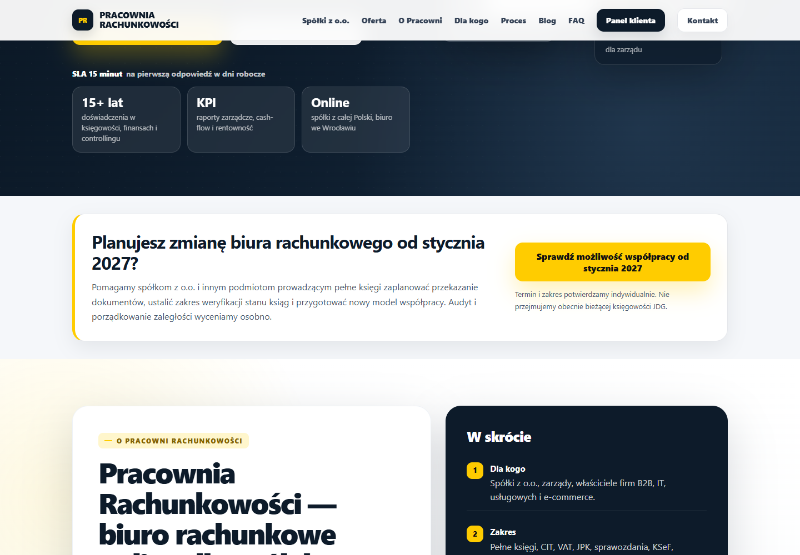
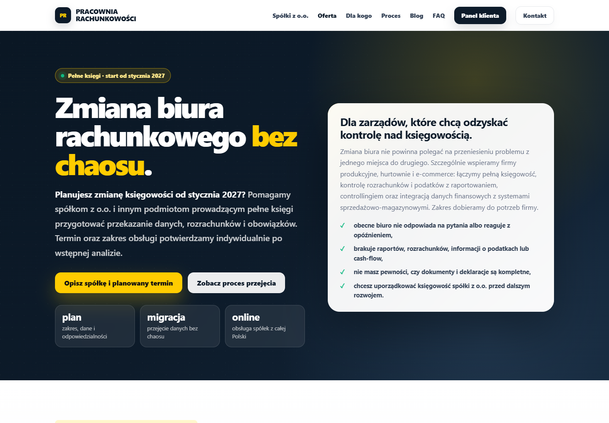
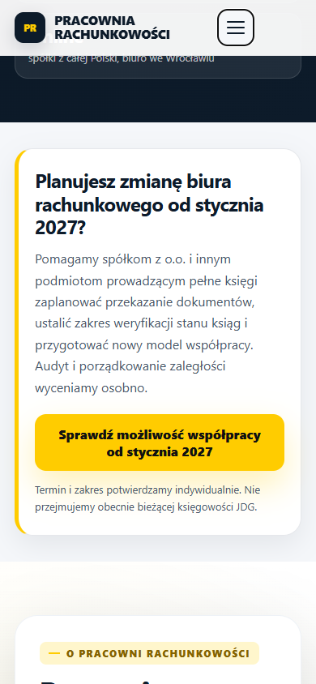
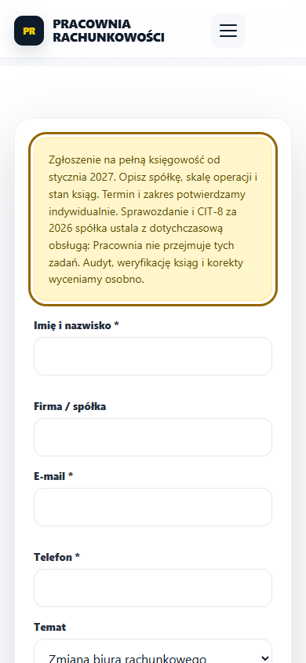

# Podgląd kampanii — desktop i mobile

Zrzuty z lokalnej gałęzi, bez publikacji. Szerokości: 1440, 390 i 360 px. Zewnętrzne skrypty i fonty były blokowane podczas testu; żadnego formularza nie wysłano do produkcji.

| Widok | Desktop 1440 px | Mobile 390 px | Mobile 360 px |
| --- | --- | --- | --- |
| Blok na stronie głównej | [Desktop](home-1440.png) | [Mobile 390](home-390.png) | [Mobile 360](home-360.png) |
| Landing przejęcia | [Desktop](landing-1440.png) | [Mobile 390](landing-390.png) | [Mobile 360](landing-360.png) |
| Harmonogram | [Desktop](plan-1440.png) | [Mobile 390](plan-390.png) | [Mobile 360](plan-360.png) |
| Formularz sezonowy | [Desktop](form-1440.png) | [Mobile 390](form-390.png) | [Mobile 360](form-360.png) |

## Strona główna — desktop

## Landing — desktop

## Strona główna i formularz — mobile

