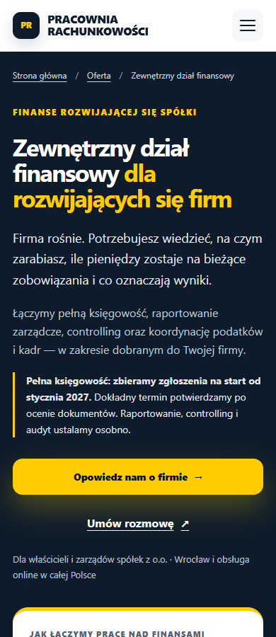

# Zewnętrzny dział finansowy — raport etapu 2

Data: **11 października 2026**. [Draft PR #19](https://github.com/pracowniarachunkowosci-debug/pracownia/pull/19), [zadanie #18](https://github.com/pracowniarachunkowosci-debug/pracownia/issues/18), [polecenie etapu 2](https://github.com/pracowniarachunkowosci-debug/pracownia/pull/19#issuecomment-6108001545).

Gałąź: `codex/zewnetrzny-dzial-finansowy`. Porównanie regresji z `main`: `0bc0dec2f70753f2093fca645092de1910c32395`. Etap 2 aktualizuje ten sam PR. Nie wykonano merge ani publikacji.

## Aktualizacja: jednorazowy test odbiorczy

**11.10.2026 o 13:29:54 CEST** wykonano dokładnie jedną zatwierdzoną rzeczywistą wysyłkę z lokalnego podglądu commitu `4738e56`: **API accepted: TAK (HTTP 200, `success: true`); e-mail received: NIEPOTWIERDZONY; GA4 measured: NIEPOTWIERDZONY; PR published: NIE**. Formularz pokazał sukces i zablokował ponowne wysłanie. W dataLayer wystąpił jeden `generate_lead`, ale Tag Assistant nie pokazał wysłanego działania GA4, a DebugView nie potwierdził zdarzenia. Dodatkowo istniejący tag Ads zadziałał już przy `gtm.formSubmit`.

Szczegóły, ograniczenia i dowód: **[raport rzeczywistej próby](acceptance-2026-10-11.md)**. Czekamy na potwierdzenie wiadomości przez właściciela. **Nie ponawiać rzeczywistej wysyłki bez nowej zgody.** Nie zmieniono konfiguracji usług ani kodu strony w ramach tego testu.

## Zmiany i naprawione usterki

1. **Dostępność:** zbieramy teraz zgłoszenia na rozpoczęcie pełnej księgowości od stycznia 2027. Dokładny termin zależy od oceny dokumentów, sald i rozrachunków. Zgodne informacje znajdują się w hero, procesie, CTA, FAQ, JSON-LD oraz kontekstowej informacji przy formularzu. Usunięto sugestię przejęcia ksiąg w trakcie 2026. Osobne raportowanie, controlling, audyt lub uporządkowanie ksiąg pozostają możliwe po odrębnym ustaleniu zakresu, wyceny i terminu.
2. **Formularz:** wcześniejszy skrypt zgłaszał `generate_lead` i Meta Lead już przy `submit`, a po 1600 ms przekierowywał do podziękowania bez sprawdzania odpowiedzi. Nowy skrypt wymaga odpowiedzi HTTP 2xx i dokładnie `success: true` z Web3Forms. Pokazuje rzeczywisty stan przy formularzu; błąd zachowuje dane i pozwala ponowić wysłanie. Podczas oczekiwania oraz po sukcesie blokuje podwójne wysłanie. Limit 30 s kończy się komunikatem o braku potwierdzenia, nie pozornym sukcesem. W razie niepewnego odbioru sugeruje kontakt przed ponowną wysyłką.
3. **Pomiar:** `click_contact` i `click_calendly` są zdarzeniami pomocniczymi (`engagement`). Własne zdarzenia CTA oraz potwierdzonego formularza są wysyłane tylko przy istniejącej zgodzie `cookieConsent=all`. Kliknięcie Calendly nie potwierdza rezerwacji. Nie dodano zdarzenia umówionego spotkania bez wiarygodnego sygnału z Calendly.
4. **Podziękowanie:** `thank-you.html` jest informacyjne i ma `noindex,follow`. Usunięto automatyczny Meta Lead, pixel noscript oraz samodzielne skrypty pomiarowe bez obsługi zgody. Samo otwarcie, odświeżenie lub powrót na tę stronę nie jest dowodem wysłania. Usunięto niepotwierdzone zapewnienia o odpowiedzi w 15 minut i już wysłanym e-mailu. Potwierdzenie sukcesu znajduje się przy formularzu, a przejście do tej strony jest opcjonalne.
5. **Mniej tarcia:** wszystkie trzy CTA kontaktowe prowadzą do `/?service=zewnetrzny-dzial-finansowy#kontakt`. Formularz wybiera temat i pokazuje kontekst usługi. Na mniejszych ekranach jest przed ogólnym blokiem kontaktu. Wejście z landingu omija długie płynne przewijanie przez stronę główną; fokus trafia do informacji nad formularzem, bez automatycznego otwierania klawiatury ekranowej.
6. **SEO:** link z raportów wskazuje model kompleksowej obsługi i nie usuwa możliwości zamówienia samych raportów. `llms.txt` wyraźnie opisuje model stałej obsługi. Poprawiono dwa nieistniejące adresy grafiki Open Graph na głównej i stronie analiz, wykorzystując istniejący `ig-image.jpg`. H1/title/canonical dotychczasowych stron, ceny i nazwy pakietów pozostały bez zmian.

Zmiana starego formularza była konieczna do usunięcia fałszywego sukcesu w wymaganej ścieżce. **Nie zmieniono klucza, endpointu, metody POST, pól kontaktowych, honeypota ani istniejących pól kampanii.** Wysyłka JSON korzysta z udokumentowanej metody [Web3Forms HTML/JavaScript](https://docs.web3forms.com/how-to-guides/html-and-javascript) i [odpowiedzi API](https://docs.web3forms.com/getting-started/api-reference). Przyjęcie przez API nie jest równoznaczne z potwierdzeniem dostarczenia wiadomości do skrzynki.

GTM/GA4 i domyślne odmowy Consent Mode v2 na głównej oraz raportach są identyczne z bazą. GrowthOS zachowuje adres skryptu, API i opcje. Adres Calendly pozostaje identyczny. Dodatkowe `try/catch` chronią kontrolki cookies na głównej przed niedostępnym `localStorage`. Nie dodano bibliotek produkcyjnych, opinii, referencji, case studies ani obietnic wyników.

## Atrybucja i wariant formularza

`service` przyjmuje wyłącznie jedną znaną wartość. Do wiadomości Web3Forms trafia `inquiry_source=zewnetrzny-dzial-finansowy` i temat „Zewnętrzny dział finansowy - nowe zapytanie”. Pozostałe wejścia otrzymują `strona-glowna`. To informacja o kontekście bieżącego zapytania, nie pełna atrybucja pierwszego kontaktu.

Potwierdzony `generate_lead` ma wyłącznie stałe parametry: `event_category`, `event_label`, `form_id`, `inquiry_source`. Nie przekazuje pól formularza, URL, nazwiska, firmy, telefonu, adresu e-mail ani wiadomości. Nie dodano cookies, pamięci sesji, wewnętrznych UTM czy identyfikatora użytkownika. Wycofana zgoda lub niedostępny zapis zgody oznacza brak własnej konwersji analitycznej, lecz formularz nadal działa. Bez JS pozostaje natywny POST i status po stronie Web3Forms; automatyczne rozpoznanie źródła i własne zdarzenie analityczne wymagają JS.

**Rekomendacja:** zachować jeden formularz z kontekstem. Nadal istnieje dodatkowa nawigacja, ale użytkownik trafia bezpośrednio do właściwego miejsca, a obsługa zapytań ma jeden punkt utrzymania. Wariant do późniejszej decyzji: formularz bezpośrednio na landingu korzystający ze wspólnego modułu obsługi, jeśli rzeczywiste dane wykażą porzucenia między CTA a wysłaniem. Nie powielano formularza ani konfiguracji kluczy.

## Rozdzielenie intencji SEO

Poniższe wnioski wynikają z analizy kodu i treści, nie z pomiaru pozycji.

| Adres | Główna intencja i rola |
| --- | --- |
| `/` | Biuro rachunkowe online dla spółek z o.o.; główne wejście, zaufanie, usługi i kontakt |
| `/oferta.html` | Katalog usług, zakresy i istniejące pakiety Start/Rozwój/Strategia |
| `/ksiegowosc-spolka-z-oo.html` | Konkretna usługa pełnej księgowości spółki; Wrocław i online |
| `/zewnetrzny-dzial-finansowy.html` | Model stałej obsługi łączący księgowość, raportowanie i pracę z zarządem; rozwijające się firmy, produkcja, hurtownie, handel |
| `/raporty-zarzadcze-controlling.html` | Cykliczne raporty, KPI, marża, cash-flow i controlling jako konkretny zakres, również odrębny |
| `/analizy-finansowe-raportowanie.html` | Jednorazowy projekt analizy wyniku, kosztów, rentowności i płynności |

Wspólne pojęcia księgowości, marży i cash-flow są uzasadnione relacją usług. Nowy landing opisuje odpowiedzialności, dobór pakietu, rytm współpracy, przejęcie i przygotowanie danych; nie zastępuje szczegółowej oferty raportów ani projektu analitycznego. Linki prowadzą w obie strony między modelem obsługi i raportami, a z landingu także do jednorazowej analizy. Zachowano self-canonical stron i hierarchię breadcrumbs: główna → oferta → zewnętrzny dział finansowy. Nowa strona nie kopiuje całego katalogu cen.

**brak dostępu do GSC**. Nie można obecnie potwierdzić ani wykluczyć kanibalizacji na podstawie wyników wyszukiwania. Nie tworzono osobnego landingu controllingu produkcji. Do dalszej decyzji potrzebne są:

- eksport Skuteczność → Wyniki wyszukiwania: zapytania i strony za ostatnie 3 miesiące wobec poprzednich 3 miesięcy, a przy sezonowości także porównanie rok do roku; pomocniczo pełne dostępne 16 miesięcy;
- kliknięcia, wyświetlenia, CTR i średnia pozycja dla obecnych pięciu adresów, z podziałem na zapytania, urządzenia i kraj; szczególnie frazy o dziale finansowym, controllingu, raportach, analizie oraz produkcji;
- raport indeksowania i map witryny, inspekcja obecnych URL (canonical wybrany przez Google), Core Web Vitals mobile/desktop;
- po osobno zatwierdzonej publikacji: inspekcja nowego URL i porównanie zapytań/przepływu między stronami po zebraniu danych. Nowy URL nie ma jeszcze historii produkcyjnej w tym PR.

## Wyniki wcześniejszego automatycznego QA (atrapy API)

Dowody: [przeglądarka](browser-report.json), [formularz](contact-report.json), [HTML/JS/integracje](technical-report.json), [SEO i cały serwis](seo-audit.json), [wydajność](performance-report.json), [odczyt usług zewnętrznych](external-readonly.json).

| Kontrola | Wynik |
| --- | --- |
| Landing: 320/390/768/900/1024/1440 px | 6 widoków bez overflow; menu, Escape, fokus, FAQ i linki działają |
| Formularz: 320/390/768/1024/1440 px | 5 widoków bez overflow; przejście z CTA, kontekst, pozycja formularza i klawiatura poprawne |
| axe WCAG 2 A/AA i 2.1 AA | 0 wykrytych naruszeń na landingu, banerze landingu i w formularzu, także po sukcesie; nie jest to audyt dostępności całego serwisu |
| JavaScript | 0 błędów przeglądarki w testowanych przepływach; 18 bloków inline i oba zmieniane skrypty zewnętrzne przechodzą kontrolę składni |
| HTML standard | Landing i podziękowanie: 0 problemów; pozostałe kontrolowane strony: 0 nowych względem main, zachowane 9 wcześniejszych wskazań walidatora |
| JSON-LD | JSON poprawny w 55 plikach HTML; Service/BreadcrumbList/FAQPage landingu poprawnie parsowane; 7 odpowiedzi FAQ dokładnie zgodnych z widoczną treścią |
| Linki, zasoby i kotwice | 26 unikalnych lokalnych odwołań landingu zwraca HTTP 200; 55 stron sprawdzonych statycznie, 0 nowych braków; sześć stron zakresu bez błędnych odwołań |
| Sitemap / llms | XML: 47 unikalnych istniejących adresów, nowy URL dokładnie raz; lastmod zmieniony tylko dla 5 edytowanych adresów względem main; 35 odnośników llms prowadzi do istniejących zasobów |
| Regresja treści | Cała wcześniejsza oferta identyczna po odjęciu sekcji etapu 1; sekcje handlowe głównej i H1/title/canonical chronione porównaniem z main |
| Integracje | Bootstrap GTM/GA4/Consent Mode i parametry GrowthOS zachowane; Calendly i plik GrowthOS: odczyt HTTP 200 |
| Zgody | Cztery odmowy przed GTM/GA4; essential/all, powrót i reset; Meta na landingu dopiero po zgodzie; własne zdarzenia CTA/sukcesu bez zgody nie są emitowane |
| Formularz — sukces | Dopiero HTTP 2xx + `success: true`: komunikat, jeden `generate_lead` i jeden Meta Lead przy zgodzie; opóźnienie oraz wielokrotne submit nie powodują wcześniejszej konwersji |
| Formularz — błędy | `success: false`, HTTP 400/403/429/500, błędny JSON, błąd sieci i timeout: dane zachowane, brak sukcesu/konwersji/przekierowania; ręczna ponowna próba działa |
| Odporność | Walidacja wymaganych pól blokuje żądanie; wyjątek analityki nie zmienia sukcesu; nieznane źródło odrzucane; brak localStorage nie blokuje wysyłki |
| Podziękowanie / bez JS | Wejście bezpośrednie, odświeżenie i powrót nie tworzą konwersji; natywny POST bez JS zachowany, bez wykonywania rzeczywistej wysyłki |
| Bezpieczne testy | 22 żądania formularza do atrap API; **0 prawdziwych leadów i 0 rezerwacji** |
| Git | `git diff --check`: bez błędów whitespace; na PR nie ma skonfigurowanych checks CI — opisane testy wykonano lokalnie |

Powyższe testy automatyczne przechwytują wszystkie zewnętrzne żądania przeglądarki. Nie sprawdzają dostarczenia wiadomości, rzeczywistego kontenera GTM, GA4 DebugView, zapisu terminu ani odpowiedzi czatu. Publiczny odczyt HTTP 200 potwierdza dostępność adresu, nie kompletny proces dostawcy. Późniejsza, jedna rzeczywista próba Web3Forms wraz z odczytem GTM/GA4 jest opisana osobno w aktualizacji na początku raportu.

### Wydajność: wyłącznie laboratorium

Chrome, lokalny serwer z gzip, pusty cache, CPU spowolnione 4×, RTT 150 ms, pobieranie 200 000 B/s, wysyłanie 93 750 B/s. Jeden przebieg na szerokość, zgoda essential, zewnętrzne skrypty zastąpione pustymi odpowiedziami.

| Widok | LCP | CLS | Najdłuższa zaobserwowana interakcja menu/FAQ |
| --- | --- | --- | --- |
| 390 px | 1900 ms | 0 | 88 ms |
| 1440 px | 1568 ms | 0 | 32 ms |

Czas interakcji to próbka Event Timing z działań testowych, **nie terenowy INP**. Powyższe wyniki nie stanowią potwierdzenia produkcyjnych Core Web Vitals; nie obejmują rzeczywistego kosztu GTM, GA4, Meta ani GrowthOS. Potrzebna będzie kontrola zaakceptowanego środowiska ze skryptami oraz dane użytkowników z GSC/CrUX po zebraniu ruchu.

### Odtworzenie

Narzędzia testowe są poza zależnościami strony. Użyto Node 20.19.5, Chrome 155, Playwright 1.64.0, axe 4.13.0, html-validate 10.17.0 i Python 3.11.

1. W katalogu repozytorium uruchom lokalny serwer statyczny. Serwer użyty do zapisanych wyników obsługiwał gzip; pomiar bez kompresji może się różnić.
2. Zainstaluj narzędzia w oddzielnym katalogu: `npm install --prefix <katalog-QA> playwright@1.64.0 @axe-core/playwright@4.13.0 html-validate@10.17.0`.
3. Ustaw `NODE_PATH=<katalog-QA>/node_modules`, `ZDF_QA_URL=http://127.0.0.1:<port>` i `ZDF_QA_OUTPUT=<katalog-raportów>`. Domyślny port skryptów to 8765; zapisane wyniki używały 8767. `ZDF_BROWSER` domyślnie wskazuje zainstalowany Chrome.
4. Uruchom `node scripts/verify-zewnetrzny-dzial-finansowy.cjs`, `node scripts/verify-contact-form.cjs`, `node scripts/verify-integrations.cjs` i `node scripts/measure-zdf-performance.cjs`.
5. Uruchom `python scripts/audit-zdf.py` (wynik zapisuje w dokumentacji), `node --check assets/js/contact-form.js`, `node --check assets/js/zewnetrzny-dzial-finansowy.js` oraz `git diff --check`.

Skrypty JS mają opcjonalne `ZDF_BASE_REF`; zapisane wyniki i audyt Python porównują z podanym wyżej commitem main. Nie należy mylić testowej odpowiedzi `success: true` z wysyłką do prawdziwego API. Dane formularza i klucz są sprawdzane w pamięci procesu, nie zapisywane do raportu QA.

## Otwarte ryzyka i sprawy poza zakresem nowej ścieżki

- API Web3Forms przyjęło jedną rzeczywistą próbę, ale odbiór e-maila nadal wymaga potwierdzenia właściciela. Odczytano konfigurację Web3Forms: pole ograniczenia domen jest puste; niczego nie zmieniono ani nie obchodzono ograniczeń.
- Odczyt GTM Preview i GA4 DebugView wykazał brak potwierdzonego przekazania `generate_lead` do GA4 oraz uruchomienie istniejącej konwersji Ads przy `gtm.formSubmit`. Pomiar nie przeszedł testu odbiorczego; wymaga osobnej diagnozy i naprawy. Nie przeprowadzono pełnego audytu reguł ani konfiguracji kluczowych zdarzeń. Parametr `inquiry_source` może wymagać rejestracji jako wymiar niestandardowy w GA4.
- Inne, niezmieniane landingi nadal mają historyczny pomiar przy `submit` i przekierowanie po 1600 ms: `case-study-estonski-cit-ecommerce.html`, `estonski-cit-ecommerce.html`, `estonski-cit-spolka-z-oo.html`, `interpretacje-estonski-cit.html`, `ksiegowosc-ecommerce.html`, `ksiegowosc-spolka-z-oo.html`, `ukryte-zyski-estonski-cit.html`, `zmiana-biura-estonski-cit.html`. Ten PR naprawia wymagany przepływ nowy landing → główna → sukces oraz wspólne podziękowanie. Rozszerzenie modułu na pozostałe formularze powinno mieć osobny zakres i testy odbioru; ich konwersji nie można obecnie uznać za zweryfikowane.
- Audyt całego serwisu wykazał **33 wcześniejsze wystąpienia brakujących zasobów/kotwic na 19 stronach** poza sześcioma stronami zakresu, w tym grafiki metadanych, nieistniejące kotwice oferty/CIT i stary URL promocji. Szczegóły są w `seo-audit.json`. Nie wykonano masowej zmiany klastrów SEO. Pozostało też 9 wcześniejszych wskazań HTML na kontrolowanych starych stronach.
- Źródło jest przenoszone tylko przez bezpośrednie CTA. Wejście do formularza później inną drogą będzie oznaczone jako główna. Bez JS formularz działa, lecz źródło nie jest automatycznie zmieniane. To świadome ograniczenie rozwiązania bez utrwalania identyfikatorów.
- Nie testowano fizycznego Androida/iPhone'a ani produkcyjnego widgetu GrowthOS w interakcji z użytkownikiem. Dostępność usług może się zmieniać.

## Kontrolowany test właściciela — przed decyzją o publikacji

**Aktualny stan:** jedyna zatwierdzona rzeczywista próba ze zgodą `all` została wykonana i opisana w [raporcie odbiorczym](acceptance-2026-10-11.md). Pozostaje potwierdzenie skrzynki oraz naprawa pomiaru. Poniższa pierwotna checklista jest planem dalszej weryfikacji, nie poleceniem ponowienia wysyłki. Każda kolejna rzeczywista wysyłka, rezerwacja lub wiadomość czatu wymaga osobnej zgody. Ten PR nie uruchamia wdrożenia.

1. Otworzyć wersję z gałęzi w zaakceptowanym środowisku, na telefonie i komputerze. W nowym profilu wybrać tylko niezbędne cookies. Z hero oraz końcowego CTA przejść do kontaktu; sprawdzić temat, komunikat stycznia 2027 i widoczność pierwszego pola.
2. Wysłać jedno oznaczone zapytanie „TEST WŁAŚCICIELA — ZDF”, z własnym dostępnym e-mailem i telefonem. W Network potwierdzić POST do tego samego API, HTTP 2xx i `success: true`. Sprawdzić komunikat przy formularzu oraz faktyczny odbiór jednej wiadomości w skrzynce (także spam), komplet pól, `inquiry_source` i temat. Nie publikować klucza ani danych kontaktowych w zrzutach QA.
3. Z samymi niezbędnymi cookies sprawdzić brak własnych `generate_lead`/Meta Lead. Następnie w osobnej, świadomie zaakceptowanej próbie ze zgodą all potwierdzić dokładnie jeden `generate_lead` w GTM Preview/GA4 DebugView po sukcesie API. Sprawdzić parametry i brak danych osobowych; kliknięcia/form_start/form_submit nie powinny być uznawane za potwierdzony lead.
4. Bez wysyłki: w DevTools zablokować endpoint API, sprawdzić błąd, zachowanie danych i brak konwersji; potem usunąć blokadę. Otworzyć bezpośrednio oraz odświeżyć `thank-you.html` — bez nowego leada. Sprawdzić Tab/Shift+Tab, Enter, Escape, czytelność statusu i ponowny wybór zgody.
5. Otworzyć Calendly i sprawdzić, że klik jest wyłącznie zdarzeniem pomocniczym. Dopiero jeśli właściciel zaakceptuje test rezerwacji: utworzyć świadomie oznaczoną rezerwację, sprawdzić zapis i powiadomienia, następnie ją anulować. Ewentualny pomiar potwierdzonego terminu wymaga wiarygodnej integracji Calendly; nie należy tworzyć go z kliknięcia.
6. Sprawdzić GrowthOS przy obu wariantach zgody: ładowanie, położenie względem banera/formularza i brak błędów. Po osobnym zaakceptowaniu wiadomości testowej zweryfikować odbiór po stronie obsługi. W tej realizacji nie wysyłano wiadomości do czatu.
7. Po ewentualnej, odrębnie zatwierdzonej publikacji zweryfikować indeksowanie, canonical i rzeczywistą wydajność. Sam pozytywny wynik lokalnego QA nie oznacza zgody na publikację.

## Decyzje właściciela

- Ocenić gotowy wariant jednego formularza. Rekomendowane pozostawienie wdrożonego rozwiązania; formularz na landingu rozważyć dopiero przy danych o porzuceniach.
- Potwierdzić odbiór jednej wykonanej wiadomości testowej; zdecydować o osobnej naprawie przekazywania zdarzenia GA4 i przedwczesnej konwersji Ads. Dalsza rzeczywista wysyłka oraz testy rezerwacji Calendly/wiadomości GrowthOS wymagają nowej zgody. Odczyt GSC pozostaje potrzebny do analizy SEO.
- Ustalić priorytet osobnej naprawy pozostałych formularzy oraz starych odwołań/HTML. Nie traktować ich jako zweryfikowanych w tym etapie.
- Wyznaczyć osobę i termin ręcznego przeglądu dostępności **przed styczniem 2027 lub wcześniej, jeśli zmienią się możliwości obsługi**. Aktualizacja obejmuje hero, proces, CTA, FAQ i JSON-LD w `zewnetrzny-dzial-finansowy.html` oraz notę w `assets/js/contact-form.js`. Data nie zmieni się automatycznie.
- Podjąć odrębną decyzję o merge i publikacji po recenzji oraz testach odbioru. Aktualny PR pozostaje draftem.

## Podglądy

[Pełny desktop](desktop.png) · [Pełny telefon](mobile.png) · [Wejście do formularza](contact-arrival.png) · [Sukces testu z atrapą API](form-success.png)
