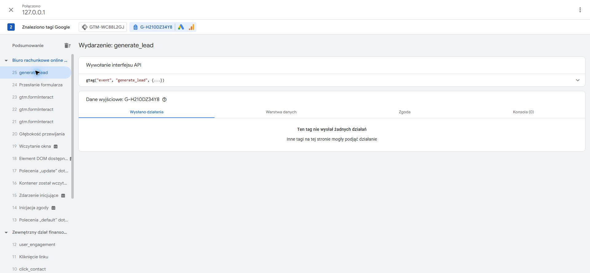

# Jednorazowy test odbiorczy — 11 października 2026

[PR #19](https://github.com/pracowniarachunkowosci-debug/pracownia/pull/19). Test zgodny z [potwierdzoną instrukcją właściciela](https://github.com/pracowniarachunkowosci-debug/pracownia/pull/19#issuecomment-6108416313), uzupełniającą [zgodę na test](https://github.com/pracowniarachunkowosci-debug/pracownia/pull/19#issuecomment-6108356495).

Testowany commit: `4738e56847d32ae972fa2ebe0fef99bf48dad6ab`, gałąź `codex/zewnetrzny-dzial-finansowy`. Podgląd lokalny `http://127.0.0.1:8767`; wejście z landingu do formularza głównej przez `/?service=zewnetrzny-dzial-finansowy#kontakt`. Użyto zatwierdzonych danych kontaktowych oraz oznaczenia **TEST ODBIORCZY ZDF — NIE JEST TO LEAD**. Dane kontaktowe, pełny payload, klucz Web3Forms i token sesji GTM Preview nie są częścią tego raportu.

## Status odbioru

| Etap | Wynik | Dowód / granica potwierdzenia |
| --- | --- | --- |
| **API accepted** | **TAK** | Jedna rzeczywista próba; HTTP **200**, JSON **`success: true`** |
| **E-mail received** | **NIEPOTWIERDZONY** | Wymaga odpowiedzi właściciela po sprawdzeniu skrzynki i spamu; odpowiedź API nie dowodzi dostarczenia |
| **GA4 measured** | **NIEPOTWIERDZONY — test pomiaru niezaliczony** | Jedno `generate_lead` w dataLayer, ale Tag Assistant dla `G-H210DZ34Y8` nie pokazuje wysłanego działania; brak tego zdarzenia w GA4 DebugView |
| **PR published** | **NIE** | Lokalny podgląd; bez merge, publikacji strony i publikacji kontenera GTM |

Początek jedynej próby: **11.10.2026, 13:29:54.116 Europe/Warsaw (CEST)**, czyli **2026-10-11T11:29:54.116Z**. Nie ponowiono rzeczywistej wysyłki. Kolejna próba wymaga nowej zgody właściciela.

## Formularz i API

- Przed wysłaniem wybrano zgodę cookies `all` oraz wymaganą zgodę formularza. Opcjonalna liczba dokumentów: „nie wiem”.
- Przeglądarka wykonała rzeczywisty POST bezpośrednio do dotychczasowego endpointu Web3Forms. Otrzymano HTTP 200 i `success: true`; nie użyto atrapy odpowiedzi.
- Po odpowiedzi formularz pokazał: **„System przyjął Twoje zapytanie. Dziękujemy — skontaktujemy się w sprawie dalszych ustaleń.”** Przycisk **„Zapytanie przyjęte”** był wyłączony. Pozostano przy formularzu, bez wymuszonego przekierowania.
- Potwierdzono kontekst wysłanego zapytania: `inquiry_source=zewnetrzny-dzial-finansowy`, temat pola „Zewnętrzny dział finansowy”, temat wiadomości „Zewnętrzny dział finansowy - nowe zapytanie” oraz obecność oznaczenia testowego.
- Panel Web3Forms sprawdzono tylko do odczytu. Pole ograniczenia domen było puste; nie zmieniono klucza, odbiorcy, ograniczeń ani zabezpieczeń.

Lokalny serwer dodawał do odpowiedzi HTML obserwator QA, bez zmiany plików produkcyjnych. Obserwator przekazywał oryginalne żądanie do natywnego `fetch`, odczytywał status i pole `success` z kopii odpowiedzi oraz zapisywał wyłącznie bezpieczne metadane. Rejestr jednorazowej próby blokował kolejne wywołanie również po przeładowaniu. Nie działał jako proxy i nie zmieniał payloadu ani odpowiedzi dostawcy. Nie zapisano pełnego HAR ani danych osobowych w repozytorium.

Stan sukcesu zweryfikowano przez interfejs i drzewo dostępności przeglądarki. Próby wykonania zrzutu lokalnego formularza zakończyły się błędem narzędzia przechwytywania; nie przedstawiamy wcześniejszego zrzutu z atrapą API jako dowodu rzeczywistej wysyłki.

## GTM i GA4

Po sukcesie API zaobserwowano dokładnie jeden własny `generate_lead`. Parametry:

```json
{
  "event_category": "lead",
  "event_label": "home_form",
  "form_id": "leadForm",
  "inquiry_source": "zewnetrzny-dzial-finansowy"
}
```

Nie było danych kontaktowych ani treści wiadomości w tym zdarzeniu. Jest to wynik dotyczący własnego `generate_lead`, nie audyt wszystkich istniejących tagów.

W GTM Preview/Tag Assistant widać wywołanie `gtag("event", "generate_lead", {...})`. Dla danych wyjściowych **G-H210DZ34Y8** widnieje jednak **„Ten tag nie wysłał żadnych działań”**. W GA4 DebugView odczytano `page_view`, `scroll`, `form_start` oraz `user_engagement`, bez `generate_lead`. Parametr `page_location` zdarzenia `page_view` wskazywał lokalne `127.0.0.1` ze źródłem usługi, co potwierdza właściwą sesję. Nie ustalono jeszcze przyczyny braku przekazania zdarzenia. Sam wpis w dataLayer nie jest dowodem zapisu w GA4.



Wykryto też istniejącą regułę GTM: **„TechSol - Formularz kontaktowy 45209”** (konwersja Google Ads) uruchomiła się raz przy **`gtm.formSubmit`**, przed potwierdzonym sukcesem API. Na tym samym zdarzeniu uruchomił się **„Google Ads User-provided Data Event roz. konwersja”**. Taki wyzwalacz nie potwierdza przyjęcia zapytania przez API i wymaga oddzielnego przeglądu. Nie utożsamiamy liczby wpisów tagów Ads z liczbą zaksięgowanych konwersji; nie sprawdzano raportów Ads. Nie było drugiej wysyłki Web3Forms ani drugiego własnego `generate_lead`.

Obszar roboczy GTM miał przed testem 0 oczekujących zmian. Nie edytowano ani nie publikowano reguł. Brak wcześniejszego dostępu do GTM/GA4 opisany w automatycznym QA został w tym teście zastąpiony rzeczywistym odczytem Preview i DebugView. Nie sprawdzano GSC.

## Dalszy krok

1. **Czekamy na właściciela:** potwierdzenie odbioru oznaczonej wiadomości w skrzynce odbiorczej lub spamie, kompletności pól i tematu. Do tego czasu status odbioru pozostaje niepotwierdzony.
2. Osobno zatwierdzić zakres naprawy przekazywania `generate_lead` do GA4 oraz przedwczesnego wyzwalacza Ads. Najpierw diagnoza i testy bez kolejnej rzeczywistej wysyłki; ponowny test Web3Forms wyłącznie po nowej zgodzie.
3. Publikacja strony, merge i publikacja GTM nadal wymagają odrębnej decyzji. Nie wykonano rezerwacji Calendly ani wiadomości GrowthOS.

Ta aktualizacja PR obejmuje tylko dokumentację i dowód QA. Wyniki wcześniejszych 22 prób z atrapami API pozostają osobnym zestawem testów regresji; nie zastępują niniejszej jednej rzeczywistej próby.
