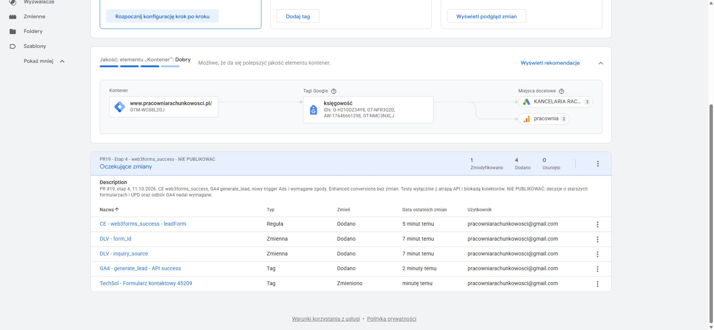

# Etap 4 — konfiguracja GTM w osobnym workspace

Data: **11.10.2026**. [Draft PR #19](https://github.com/pracowniarachunkowosci-debug/pracownia/pull/19), [polecenie właściciela](https://github.com/pracowniarachunkowosci-debug/pracownia/pull/19#issuecomment-6109121441). Badany kod strony: `6ce63dc2e9a48b58bd0fc5d5e1bf5fb48b063162`, gałąź `codex/zewnetrzny-dzial-finansowy`.

**Konfiguracja zapisana i sprawdzona w Preview, bez publikacji. GA4 measured: NIEPOTWIERDZONE.** W tym etapie nie zmieniano kodu strony, cen, pakietów, formularzy ani pozostałych integracji produkcyjnych. Nowe skrypty służą wyłącznie lokalnemu QA. Nie wykonano merge, wdrożenia, rzeczywistej wysyłki Web3Forms, rezerwacji ani wiadomości GrowthOS. Nie zmieniono enhanced conversions ani ustawień konta Ads.

## Stan i punkt wyjścia

- Kontener `GTM-WC88L2GJ`, konto `6321819993`, container ID `234024853`, GA4 `G-H210DZ34Y8`.
- [Workspace 6: **PR19 - Etap 4 - web3forms_success - NIE PUBLIKOWAC**](https://tagmanager.google.com/#/container/accounts/6321819993/containers/234024853/workspaces/6).
- **5 oczekujących zmian: 4 dodane, 1 zmodyfikowana, 0 usuniętych.** Nie użyto Prześlij/Submit/Publish. Zastana wersja opublikowana: **4**, z 8.12.2025, godz. 13:19:18 według UI GTM. Nie utworzono nowej opublikowanej wersji.
- Przed edycją odczytano obiekty i wyeksportowano Default Workspace (ID 5, 0 zmian). Edycje wykonano wyłącznie w nowym workspace; domyślnego nie modyfikowano. Wyeksportowano też końcowy workspace 6.
- Pełne eksporty pozostają lokalnie poza repozytorium: `zdf-qa/stage4/gtm-baseline-workspace5.json` i `zdf-qa/stage4/gtm-workspace6.json` w katalogu nadrzędnym checkoutu. To kopie do odzyskania i porównania, nie pliki do automatycznego importu. Przy przywracaniu trzeba uwzględnić późniejsze zmiany innych osób.

| Eksport | SHA-256 |
| --- | --- |
| Baseline workspace 5 | `46759f6001e01b365fa9827be0229f908ffd40a692765f41eb2b097101f9060f` |
| Draft workspace 6 | `04cde2ee9016fd2c00cc0308f830902f20fde596d49c3ee38449b0a901d99867` |

[Porównanie eksportów i konkretne ustawienia](workspace-review.json). Raport nie zawiera tokenu Preview, klucza Web3Forms ani danych kontaktowych z formularza.

## Zapisane obiekty

| ID | Obiekt | Konfiguracja |
| --- | --- | --- |
| Variable 11 | `DLV - form_id` | Data Layer Variable, wersja 2, klucz `form_id`, bez wartości domyślnej |
| Variable 12 | `DLV - inquiry_source` | Data Layer Variable, wersja 2, klucz `inquiry_source`, bez wartości domyślnej |
| Trigger 13 | `CE - web3forms_success - leadForm` | Custom Event, dokładnie `web3forms_success`; `form_id` równe `leadForm`; `inquiry_source` pasuje do `^(zewnetrzny-dzial-finansowy\|strona-glowna)$` |
| Tag 14 | `GA4 - generate_lead - API success` | GA4 Event, `G-H210DZ34Y8`, `generate_lead`, wyłącznie trigger 13, raz na zdarzenie, dodatkowo wymaga `analytics_storage` |
| Tag 5 | `TechSol - Formularz kontaktowy 45209` | Stary trigger 6 zastąpiony triggerem 13; raz na zdarzenie; dodatkowo wymaga `ad_storage`, `ad_user_data`, `ad_personalization` |

GA4 ma dokładnie cztery parametry: stałe `event_category=lead`, `event_label=home_form` oraz `form_id={{DLV - form_id}}`, `inquiry_source={{DLV - inquiry_source}}`. Wyzwalacz ogranicza zmienne do opisanych wartości. Bez danych z pól formularza, `user_data`, identyfikatora leada i dodanego `debug_mode`. Kod strony emituje sygnał dopiero po HTTP 2xx + boolean `success:true` i przy aktualnej zgodzie `all`; blokady `pending`/`completed` zapobiegają duplikatom z wielokrotnego submit. „Raz na zdarzenie” w GTM nie jest globalną deduplikacją dwóch osobnych zdarzeń; dlatego istotny jest test kodu formularza.

W tagu Ads zachowano wszystkie dotychczasowe parametry, w tym **conversion ID `17646661298`**, **label `_YKtCLH_gcobELLdyt5B`**, ustawienia wartości oraz istniejące `user_data={{Dane przekazywane przez użytkowników}}`. Zmieniono wyłącznie regułę, częstotliwość i dodatkowe wymagania zgód. Nie pozostawiono równoległego wyzwalacza `form_submit`.

Bez zmian, potwierdzone porównaniem obiektów eksportu: tag 4 Conversion Linker, tag 7 Google Tag, **tag 9 UPD**, reguły 3 i **6 (`form_submit`)**, zmienna **8 UPD** oraz zmienne wbudowane. Reguła 6 pozostaje potrzebna istniejącemu tagowi 9 — nie usunięto jej. Nie zmieniono Consent Mode w kodzie ani globalnych ustawień tagu Google.

## Wyniki bezpiecznych testów

Rzeczywisty **GTM Preview workspace 6** uruchomiono na lokalnym podglądzie gałęzi. Odpowiedzi Web3Forms były atrapami. Fixture działał przed bootstrapem strony; CSP blokowała zewnętrzne `connect`, obrazy, ramki i POST. Dozwolone były tylko skrypty konfiguracji/debuggera Google. Dodatkowy wrapper blokował fetch do kolektorów i zapisywał jedynie origin/path, bez query i payloadów. Testowe pola zawierały wyłącznie dane syntetyczne. Nie wyłączano zabezpieczeń dla uzyskania zielonego wyniku Ads.

| Scenariusz Preview | Wynik |
| --- | --- |
| ZDF, zgoda all, sukces API + wielokrotny submit | 1 atrapa API, 1 `web3forms_success`, GA4 tag 14 raz; Ads tag 5 jedna próba, wysyłka zablokowana |
| Główna, zgoda all, sukces API + wielokrotny submit | 1 atrapa API, 1 sygnał ze źródłem `strona-glowna`, oba tagi na właściwym CE |
| Poprawny syntetyczny CE przy essential | Oba tagi jawnie w sekcji „Tagi zablokowane przez ustawienia dotyczące wyrażania zgody”; wszystkie cztery zgody `denied` |
| Złe `form_id`; niedozwolone `inquiry_source` | GA4 14 i Ads 5 nie uruchamiają się |
| Stare `form_submit` | GA4 14 i Ads 5 nie uruchamiają się; pozostawiony UPD 9 nadal próbuje działać |
| HTTP 500 i ponowienie na atrapie | 2 atrapy, 0 sygnałów sukcesu, dane zachowane, poprawny błąd; GA4 14 i Ads 5 nie uruchamiają się |
| Timeout | 1 atrapa, 0 sygnałów sukcesu, komunikat o braku potwierdzenia; GA4 14 i Ads 5 nie uruchamiają się |
| Sukces API przy essential | 1 atrapa, komunikat sukcesu, 0 własnych CE; GA4 14 i Ads 5 nie uruchamiają się |

Łącznie **7 przebiegów podłączonego Preview, 6 żądań do atrap**. Zły formularz, złe źródło i stary submit były trzema zdarzeniami jednego przebiegu. Wcześniejsza próba techniczna w zwykłej karcie lokalnej wykonała jeszcze 1 żądanie do atrapy API; nie jest dowodem GTM Preview. Razem z regresją offline: 37 atrap. **0 nowych prawdziwych leadów; kolektory pomiarowe zablokowane we wszystkich testach.** Ruch administracyjny GTM/Tag Assistant i pobranie konfiguracji nie są pomiarem konwersji.

Tag Assistant pokazywał przy GA4 „Powodzenie”, a przy Ads próbie „Niepowodzenie” z blokadą kolektora. **Oznacza to wynik wykonania tagu w Preview, nie odbiór `generate_lead` w GA4, nie konwersję reklamową i nie zakończony test end-to-end.** Lista `observedScriptRequests` zawiera również próby zablokowane CSP; nie jest listą skutecznych pobrań. Zachowany tag UPD może wykonać się wielokrotnie przy starych submit, również przy essential; to nie dowodzi wysyłki danych ani zliczenia drugiej konwersji. Kolektory były blokowane.

Dowody: [Preview JSON](preview-report.json), [sukces](preview-success.jpg), [odmowa zgód](preview-consent-denied.jpg).

Dodatkowa regresja kodu w rzeczywistym Chrome, całkowicie offline: **23 kontrole PASS, 30 żądań do atrap** — walidacja, opóźnienie, duplikacja, strict success, HTTP 400/403/429/500, JSON/sieć/timeout, ponowienie, zmiany zgody w trakcie oczekiwania, brak storage, brak PII, wyjątki analityki i podziękowanie. [Pełne wyniki](conversion-report.json).

Kontrola eksportów: **5 grup asercji PASS**, w tym brak niezamierzonych zmian UPD, dokładne filtry, parametry i zgody. Regresja integracji/HTML/JS: **PASS, 18 bloków inline, 0 nowych problemów HTML**; bootstrap GTM/GA4/Consent Mode, GrowthOS, Calendly i linki bez regresji. [Wynik techniczny](technical-report.json). Składnia obu nowych skryptów i `git diff --check`: PASS. Testy nie stanowią audytu całego konta ani potwierdzenia produkcyjnego GA4.

## Google Ads — odczyt primary/secondary i importów

Sprawdzono wszystkie **16 działań** na dwóch stronach listy z filtrem „Stan: Wszystkie”, a następnie szczegóły właściwej konwersji i obu importów GA4. Nie edytowano ustawień. Wcześniejsze ostrzeżenie o ad blockerze było ukrytym elementem DOM; widoczny panel działał, co potwierdził screenshot i odczyt szczegółów. Nie zmieniano zabezpieczeń przeglądarki.

| Działanie | Odczytany status | Znaczenie |
| --- | --- | --- |
| `TechSol - Formularz kontaktowy 69747`, action ID `7402979249` | **Podstawowe**, Jedna, uwzględnione w celach konta | ID `17646661298` i label `_YKtCLH_gcobELLdyt5B` dokładnie odpowiadają tagowi 5. Inna końcówka nazwy w GTM (`45209`) nie oznacza innej konwersji. |
| `pracownia (web) lead_formularz`, action ID `7382427293` | Import GA4 `lead_formularz`, **Dodatkowy**, Każda, poza celami konta | Nie jest drugim podstawowym celem formularza w odczytanej konfiguracji. To inne zdarzenie niż nowe `generate_lead`. |
| `Rezerwacja terminu`, action ID `7372277673` | Import GA4 `ads_conversion_Rezerwacja_terminu_1`, **Podstawowe**, Każda, cel konta | UI wskazuje **„Wczytanie strony: /blog/zmiana-biura.html”**. To nie dowód potwierdzonej rezerwacji. Osobne ryzyko jakości pomiaru, bez zmian w tym etapie. |

Nie znaleziono importu `generate_lead` na pełnej odczytanej liście. Rekomenduję zachować jeden podstawowy cel potwierdzonego formularza; nie dodawać nowego importu GA4 jako drugiego podstawowego obok natywnego Ads. Nie audytowano celów niestandardowych ani wyjątków poszczególnych kampanii, ani reguł tworzenia `lead_formularz` w GA4. Status secondary nie wyklucza szczególnych konfiguracji kampanii. Nie uznajemy tego za globalne potwierdzenie braku duplikacji całego konta.

**Dodatkowa decyzja właściciela:** wycofać oparty na odsłonie cel „Rezerwacja terminu” z optymalizacji albo zastąpić go rzeczywistym potwierdzeniem rezerwacji. Sam klik Calendly lub odsłona artykułu nie wystarcza. Zmiana primary/secondary i integracja rezerwacji wymagają odrębnego zakresu i akceptacji.

Dowody konfiguracji: [audyt Ads JSON](ads-review.json), [mapowanie ID/label](ads-conversion-mapping.jpg), [import formularza](ads-ga4-import.jpg), [reguła rezerwacji](ads-reservation-rule.jpg). Nie publikujemy historii wyników kampanii.

## Starsze formularze — wymagane rozstrzygnięcie przed publikacją

Poniższe **8 aktywnych formularzy** nadal ma historyczny pomiar przy submit i przekierowanie po 1600 ms. Nie emituje nowego `web3forms_success`:

- `case-study-estonski-cit-ecommerce.html`
- `estonski-cit-ecommerce.html`
- `estonski-cit-spolka-z-oo.html`
- `interpretacje-estonski-cit.html`
- `ksiegowosc-ecommerce.html`
- `ksiegowosc-spolka-z-oo.html`
- `ukryte-zyski-estonski-cit.html`
- `zmiana-biura-estonski-cit.html`

**Publikacja obecnego workspace odłączy pomiar Ads tagu 5 dla tych formularzy.** Ich historyczna emisja GA4 pozostaje w kodzie, ale nie jest tu zweryfikowana. `assets/js/main.js` zawiera też dawny ogólny handler; cztery wpisy blogowe, które go ładują, nie mają aktywnego formularza. Nie dopisywano fikcyjnego sukcesu ani alternatywnego triggera submit, który przywróciłby przedwczesne zliczanie.

**Rekomendacja: migracja ośmiu formularzy przed publikacją GTM.** Po akceptacji zakresu:

1. Przenieść formularze na wspólny handler potwierdzający HTTP 2xx + boolean `success:true`; zachować odbiorców, klucze, pola, honeypot i istniejącą treść/SEO.
2. Usunąć historyczne konwersje przy submit i timer 1600 ms; wdrożyć pending/completed, komunikaty błędu i kontrolowane ponowienie.
3. Nadać stałe, jawne identyfikatory formularzy/źródeł, rozszerzyć allowlistę GTM tylko o uzgodnione wartości, zachować dane kontaktowe poza GA4 i dataLayer.
4. Powtórzyć dla każdej ścieżki macierz sukces/błąd/timeout/duplikacja/zgody na atrapach. Uzgodnić równoczesny odbiór kodu i konfiguracji, zanim cokolwiek zostanie opublikowane.

Alternatywa do wyraźnej decyzji właściciela: świadomie zaakceptować czasowy brak Ads dla ośmiu formularzy, z zakresem i terminem migracji. Nie rekomenduję przywracania obu wyzwalaczy w jednym tagu.

## Enhanced conversions — dwa warianty, żadnego nie zastosowano

Zmienna 8 automatycznie wykrywa e-mail; tag 9 nadal reaguje na `form_submit`, a tag 5 wciąż ma `user_data`. Kod formularza czyści pola przed CE, więc po zmianie momentu konwersji nie można zakładać dostępności e-maila w automatycznym odczycie DOM. Preview potwierdził pozostawioną starą ścieżkę UPD także przy błędzie i timeout. Nie oznacza to potwierdzonego transferu ani poprawnego działania EC.

- **A — rekomendacja do osobnej akceptacji:** czasowo wstrzymać tag 9, usunąć `user_data` z tagu 5 i skontrolować automatyczne zbieranie UPD we współdzielonym Google tagu. Zweryfikować standardową konwersję bez EC i dopiero później rozważyć EC. Samo wstrzymanie tagu 9 nie wyłącza wszystkich obecnych miejsc UPD.
- **B — zachować EC po odrębnej ocenie:** ustalić wymagania zgód i dozwolony zakres danych, moment pozyskania e-maila wobec resetu formularza, jeden kontrolowany kanał do Ads, retencję i wycofanie zgody. Nigdy nie dodawać e-maila/telefonu do GA4 ani ogólnego dataLayer. Dopiero po osobnej zgodzie przygotować implementację, testy i ewentualny odbiór kolektora.

## Decyzje wymagające akceptacji

1. **Starsze formularze:** rekomendowana migracja 8 formularzy przed publikacją albo świadomie zaakceptowany, tymczasowy brak ich pomiaru Ads.
2. **Enhanced conversions:** wariant A (czasowo standardowy Ads bez UPD we wszystkich obecnych miejscach) albo osobno oceniony wariant B. Nie zmieniono żadnego ustawienia EC.
3. **Cel „Rezerwacja terminu”:** korekta podstawowego celu opartego na odsłonie, po odrębnej akceptacji; nie podłączać nowego `generate_lead` jako drugiego podstawowego celu tego samego leada.
4. **Odbiór GA4/Ads z rzeczywistym kolektorem:** osobna zgoda na konkretny test, preferencyjnie w uzgodnionym środowisku testowym, z potwierdzeniem parametrów i braku duplikacji. To nie obejmuje zgody na kolejną rzeczywistą wysyłkę Web3Forms. Dzisiejszy Preview nie potwierdza odbioru w Google.
5. **Publikacja GTM, merge PR i wdrożenie strony:** dopiero jako odrębna decyzja po zamknięciu powyższych kwestii i odbiorze kodu razem z konfiguracją. Workspace jest przygotowany do przeglądu, nie do bezwarunkowej publikacji.

## Odtworzenie testów bez wysyłki

1. `node scripts/verify-gtm-workspace.cjs <eksport-baseline.json> <eksport-workspace6.json>` — offline, porównuje eksporty pobrane przez UI GTM.
2. `ZDF_QA_OUTPUT=docs/zewnetrzny-dzial-finansowy/stage4` i `node scripts/preview-contact-qa.cjs`; otworzyć `http://127.0.0.1:8768/__qa__/run` w Chrome. Skrypt sam zapisuje wynik 23 kontroli. Składnia ustawienia zmiennej środowiska zależy od powłoki.
3. `node scripts/preview-gtm-qa.cjs`; w Preview workspace 6 podłączyć **wyłącznie localhost** `http://127.0.0.1:8769/`. Parametry `qa_consent=all|essential`, `qa_case=success|error|timeout|synthetic|negative`, opcjonalnie `service=zewnetrzny-dzial-finansowy`. Uruchomić przyciskiem fixture albo `qa_autorun=1`.
4. Zachować CSP i blokadę fetch bez zmian. Nie podłączać tego testu do produkcyjnego adresu. Nie wprowadzać prawdziwych danych. Timeout fixture skraca wyłącznie timer 30 s do 1,2 s; produkcyjny kod pozostaje bez zmian. Po testach zamknąć lokalny debug i serwery.
5. `NODE_PATH=<katalog-QA>/node_modules`, `ZDF_QA_OUTPUT=docs/zewnetrzny-dzial-finansowy/stage4`, `node scripts/verify-integrations.cjs`; `node --check scripts/preview-gtm-qa.cjs`; `node --check scripts/verify-gtm-workspace.cjs`; `git diff --check`.

Dokumentacja Google: [Data Layer](https://developers.google.com/tag-platform/tag-manager/datalayer), [Custom Event](https://support.google.com/tagmanager/answer/7679219?hl=en), [GA4 Event](https://support.google.com/tagmanager/answer/13034206?hl=en), [kontrola zgód](https://support.google.com/tagmanager/answer/10718549?hl=en), [workspaces](https://support.google.com/tagmanager/answer/7059647?hl=en), [enhanced conversions](https://support.google.com/google-ads/answer/13262500?hl=en).
