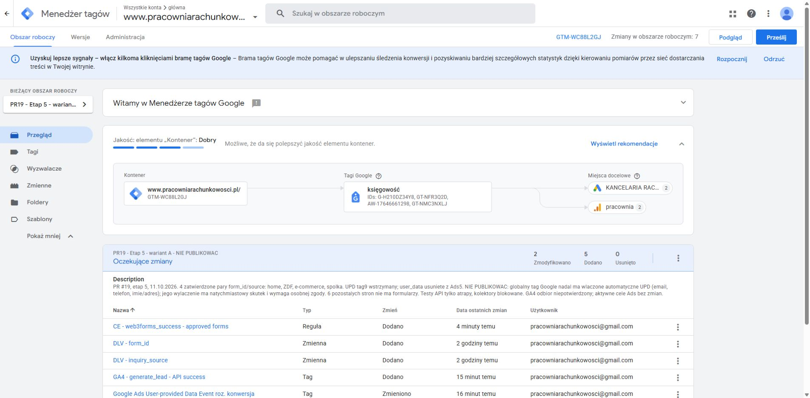

# Etap 5 — formularze, GTM i wariant A (nieopublikowane)

11.10.2026. [Draft PR #19](https://github.com/pracowniarachunkowosci-debug/pracownia/pull/19), [zatwierdzony zakres](https://github.com/pracowniarachunkowosci-debug/pracownia/pull/19#issuecomment-6109939998). Gałąź `codex/zewnetrzny-dzial-finansowy`, punkt wyjścia `872e7183f2128046136716a1300584d206cdf394`. Nie resetowano wcześniejszych zmian.

**Kod i wersjonowany draft GTM przygotowano. Niczego nie opublikowano. Pełny wariant A wymaga jeszcze zatwierdzonego wyłączenia globalnego automatycznego UPD. Odbiór konwersji GA4 pozostaje NIEPOTWIERDZONY.** Nie zmieniono aktywnych celów Ads, nie wykonano merge, rzeczywistych wysyłek Web3Forms, rezerwacji ani wiadomości GrowthOS. GitHub Pages korzysta z `main` i ścieżki `/` (odczyt API); push gałęzi PR nie jest wdrożeniem.

## Inwentaryzacja i korekta poprzedniego raportu

Etap 4 błędnie określał osiem wystąpień starego handlera jako osiem formularzy. Przed edycją sprawdzono całe HTML oraz faktyczny DOM: **tylko dwie wskazane strony zawierają formularz**. Sześć pozostałych zawierało martwy kod i linki Calendly. Nie dodawano fikcyjnych formularzy, kluczy ani odbiorców. [Inwentaryzacja sprzed edycji](inventory-before.json), [porównanie po migracji](inventory-verified.json).

| Strona ze specyfikacji | Faktyczny stan / wykonanie | Regresja z atrapą | Nowy odbiór e-maila |
| --- | --- | --- | --- |
| `case-study-estonski-cit-ecommerce.html` | 0 formularzy; usunięty martwy handler | DOM/nawigacja/brak fałszywego leada PASS; API nie dotyczy | Nie dotyczy |
| `estonski-cit-ecommerce.html` | 0 formularzy; usunięty martwy handler | DOM/nawigacja/brak fałszywego leada PASS; API nie dotyczy | Nie dotyczy |
| `estonski-cit-spolka-z-oo.html` | 0 formularzy; usunięty martwy handler | DOM/nawigacja/brak fałszywego leada PASS; API nie dotyczy | Nie dotyczy |
| `interpretacje-estonski-cit.html` | 0 formularzy; usunięty martwy handler | DOM/nawigacja/brak fałszywego leada PASS; API nie dotyczy | Nie dotyczy |
| `ksiegowosc-ecommerce.html` | 1 formularz zmigrowany na wspólny moduł | 23 kontrole / 30 atrap PASS + rozszerzone QA | Nie badano |
| `ksiegowosc-spolka-z-oo.html` | 1 formularz zmigrowany na wspólny moduł | 23 kontrole / 30 atrap PASS + rozszerzone QA | Nie badano |
| `ukryte-zyski-estonski-cit.html` | 0 formularzy; usunięty martwy handler | DOM/nawigacja/brak fałszywego leada PASS; API nie dotyczy | Nie dotyczy |
| `zmiana-biura-estonski-cit.html` | 0 formularzy; usunięty martwy handler | DOM/nawigacja/brak fałszywego leada PASS; API nie dotyczy | Nie dotyczy |

Regresja strony głównej/ZDF: kolejne **23 kontrole / 30 atrap PASS**. Jedyny wcześniejszy test rzeczywisty dotyczył wspólnego formularza etapu 2, a jego odbiór potwierdził właściciel; nie dowodzi dostarczania wiadomości z dwóch starszych formularzy.

Zachowano `id="leadForm"` w istniejącym HTML, endpoint Web3Forms, POST, indywidualne klucze i tematy, pola wymagane, honeypot, UTM/GCLID/FBCLID, opcje select, treści zgód i przyciski. E-commerce ma m.in. własne pole `channels`; moduł przekazuje wszystkie dotychczasowe pola przez FormData. Odbiorca wynika z zachowanego klucza dostawcy; nie zgadywano skrzynki i nie ujawniono kluczy w raportach.

## Wspólny mechanizm

`assets/js/contact-form.js` inicjuje formularze po `data-contact-form`, używa kontrolek/statusu z danego formularza i toleruje brak opcjonalnego odnośnika dalszego kroku. Idempotentna inicjalizacja zabezpiecza przed ponownym załadowaniem skryptu. Identyfikator pomiarowy jest stałym kontraktem i nie musi być DOM id.

- Sukces wymaga **HTTP 2xx oraz boolean `success === true`**. Brak sukcesu przy samym submit, `success:false`, tekście `"true"`, błędnym JSON i błędzie HTTP.
- Blokady pending/completed chronią wysyłkę i sygnał przed duplikacją. Po błędzie dane pozostają i użytkownik może ponowić próbę. Timeout 30 s komunikuje brak potwierdzenia i możliwość sprawdzenia odbioru telefonicznie przed ponowieniem.
- Status `role=status`, `aria-live=polite`, fokus po odpowiedzi i `aria-busy` przy oczekiwaniu. Zachowano oryginalną etykietę przycisku po błędzie. Lokalny arkusz styluje komunikaty dwóch starszych formularzy.
- Usunięto konwersję GA4/Meta na submit i przekierowanie po 1600 ms. `thank-you.html` nadal nie emituje konwersji.
- Jeden `web3forms_success` po potwierdzonym sukcesie i aktualnym `cookieConsent=all`. Brak dostępu do storage oznacza brak własnego sygnału konwersji. Cofnięcie/udzielenie zgody podczas oczekiwania oceniane jest przy odpowiedzi. Zmiana zgody po sukcesie nie odtwarza zdarzenia.
- Do własnego zdarzenia trafiają wyłącznie stałe `event_category`, `event_label`, `form_id`, `inquiry_source`. Żadne pola kontaktowe, wiadomość ani URL nie są kopiowane do niego. GA4/Ads obsługuje GTM; nie ma równoległego `gtag('event','generate_lead')`.
- Usunięcie ukrytego target iframe przywraca widoczną odpowiedź dostawcy przy natywnym POST bez JS. Test bez skryptów potwierdził action/method i dostępny przycisk, **bez wykonania natywnej wysyłki**. Odpowiedź dostawcy, antyspam i doręczenie wymagają osobnego odbioru live.

Nie zmieniono cen, pakietów, treści ofertowych, istniejących referencji, title/H1/canonical/JSON-LD ani adresów Calendly i konfiguracji GrowthOS. Bootstrap GTM/Consent Mode pozostaje niezmieniony. Dodano jedynie ochronę przed wyjątkiem storage w istniejącym kodzie banera dwóch formularzy. Dotychczasowe zdarzenia kliknięć Calendly pozostają pomocnicze; nie dodano konwersji potwierdzającej rezerwację.

## Workspace GTM 6

[PR19 - Etap 5 - wariant A - NIE PUBLIKOWAC](https://tagmanager.google.com/#/container/accounts/6321819993/containers/234024853/workspaces/6), kontener `GTM-WC88L2GJ`. **7 oczekujących zmian względem publikacji: 5 dodanych obiektów, 2 zmodyfikowane tagi, 0 usuniętych.** Nie użyto Prześlij/Publish. Wersja produkcyjna 4 pozostała bez zmian.

Przed edycją świeży eksport porównano z etapem 4: wszystkie obiekty identyczne; różnił się wyłącznie regenerowany fingerprint całego containerVersion. Kopie poza repo: `../zdf-qa/stage5/gtm-before.json`, `gtm-after.json`. [Walidacja eksportów i pełne ustawienia](workspace-review.json).

| Obiekt | Końcowa konfiguracja |
| --- | --- |
| DLV 11 / 12 | `form_id`, `inquiry_source`, v2, bez domyślnej wartości; bez zmian |
| Variable 16 | `Template - form pair`, natywny typ Constant: `{{DLV - form_id}}\|{{DLV - inquiry_source}}` (separator to literalny znak `\|`, bez backslasha) |
| Trigger 13 | `CE - web3forms_success - approved forms`; dokładne zdarzenie `web3forms_success`, regex poniżej na `Template - form pair` |
| GA4 tag 14 | `generate_lead`, `G-H210DZ34Y8`, tylko trigger 13, ONCE_PER_EVENT, dodatkowo `analytics_storage` |
| Ads tag 5 | tylko trigger 13, ONCE_PER_EVENT; usunięty parametr `user_data`; wymagane `ad_storage`, `ad_user_data`, `ad_personalization` |
| UPD tag 9 | **paused** w draft; stary trigger 6 pozostaje przy wstrzymanym tagu |

GA4 ma cztery parametry: `event_category=lead`, `event_label={{DLV - form_id}}`, `form_id={{DLV - form_id}}`, `inquiry_source={{DLV - inquiry_source}}`. Etykieta nie oznacza już błędnie `home_form` dla wszystkich stron. Zmienna 16 służy tylko filtrowaniu, nie jest dodatkowym parametrem GA4. Nie użyto Custom JavaScript/unsafe-eval.

```text
^(leadForm\|(strona-glowna|zewnetrzny-dzial-finansowy)|ecommerceForm\|ksiegowosc-ecommerce|spolkaForm\|ksiegowosc-spolka-z-oo)$
```

| form_id | inquiry_source |
| --- | --- |
| leadForm | strona-glowna |
| leadForm | zewnetrzny-dzial-finansowy |
| ecommerceForm | ksiegowosc-ecommerce |
| spolkaForm | ksiegowosc-spolka-z-oo |

Lista sprawdza **pary**, nie dowolne połączenia dwóch znanych wartości. Sześć stron bez formularzy nie jest dopuszczonych. Tagi 4 i 7, reguły 3 i 6, zmienne 8/11/12, identyfikator i label Ads, wartość oraz waluta pozostały bez zmian. „Raz na zdarzenie” GTM nie deduplikuje dwóch odrębnych zdarzeń; przed nimi chroni kod formularza.



**Ograniczenie wariantu A:** globalny tag Google ma nadal automatyczne UPD (e-mail, telefon, imię/adres). Wyłączenie w tym panelu działa natychmiast poza workspace, dlatego nie zostało zapisane. Szczegółowy [plan globalnego UPD i Google Ads](ads-plan.md) obejmuje tę blokadę i wyłączenie fałszywej „Rezerwacji terminu”.

## Testy i dowody

Testy uruchomiono na prawdziwym lokalnym HTML i zmienionym module, z atrapami Web3Forms, stubem Meta oraz CSP blokującą połączenia zewnętrzne i natywny POST. API testowe nie loguje kluczy ani treści formularzy; sprawdza zgodność pól w pamięci.

- **69 kontroli regresji / 90 atrap PASS**: [home/ZDF](conversion-report.json), [e-commerce](conversion-report-ksiegowosc-ecommerce.json), [spółka](conversion-report-ksiegowosc-spolka-z-oo.json). Każdy zestaw obejmuje sukces 200/201, invalid, slow/duplicate submit, success false/string, HTTP 400/403/429/500, malformed JSON, sieć, timeout/retry, essential/all/none/unknown, cofnięcie zgody, storage, brak PII, błędy gtag/GTM/Meta, brak konwersji na thank-you.
- **18 rozszerzonych kontroli / 6 atrap PASS**: [raport](extended-report.json). Storage niedostępne przed inicjalizacją; inny DOM id i brak opcjonalnego next-link; podwójne ładowanie modułu; szerokości 320/390/768/1024/1440; brak skryptów/natywna ścieżka; DOM wszystkich 6 stron bez formularza. Axe WCAG A/AA: zero naruszeń w obszarze formularzy po sukcesie. Wyłączono z zakresu axe tylko ikonę wstrzykiwaną przez menedżer haseł przeglądarki (`password-manager-field-logo-imgId-*`), która nie jest kodem repo; nie wyłączano rozszerzenia ani zabezpieczeń.
- **HTML/JS/integracje PASS**: [14 stron, 50 bloków JS, zero nowych błędów HTML](technical-report.json). Zastane ostrzeżenia są wymienione, a nie ukryte.
- **SEO/linki PASS**: [55 dokumentów, 47 URL sitemap, zero nowych uszkodzonych linków](seo-audit.json); 33 zastane uszkodzone odnośniki w całym serwisie pozostają poza zakresem. Dotychczasowe metadane/pola/zgody/odnośniki potwierdza osobny audyt migracji.
- **Eksport GTM PASS**: `verify-gtm-stage5.cjs`, zamknięta allowlista, wszystkie kombinacje znanych i nieznanych wartości, paused UPD, brak user_data w Ads, brak PII w parametrach GA4, niezmienione pozostałe obiekty.

Rzeczywisty **GTM Preview** pobierał konfigurację/debug GTM, ale CSP + wrapper fetch blokowały wszystkie kolektory, piksele i formularze zewnętrzne. [Rejestr scenariuszy](preview-report.json), [dowód uruchomień](preview-success.jpg). Komunikat GA4 „uruchomiono” oznacza wykonanie tagu; Ads „nie udało się uruchomić” wynika z celowej blokady transportu. **Nie potwierdza to odebrania konwersji przez Google.** Wstrzymany tag 9 i blokada globalnych prób UPD to odrębne kwestie.

Końcowy przebieg Preview: **9 scenariuszy PASS / 8 atrap API**, zero rzeczywistych wysyłek i żądań do kolektorów. Cztery dozwolone ścieżki potwierdziły po jednym sygnale i uruchomieniu obu tagów mimo wielokrotnego submit. Pozostałe pięć scenariuszy: spółka/essential, syntetyczny poprawny sygnał przy denied, pięć błędnych par plus stary form_submit, e-commerce/HTTP 500 z ponowieniem i spółka/timeout — bez uruchomienia konwersji. Tag 9 pozostał paused. [Stan odmowy czterech zgód](preview-consent-denied.jpg), [odrzucone sygnały](preview-negative.jpg). Pierwsze pięć zapisów tagButtons pochodzi z textContent przycisków i zawiera też ukryte etykiety UI; status oceniano z widocznego Preview i liczników uruchomień, a paused potwierdza eksport.

Łącznie końcowe zestawy offline: **87 kontroli / 96 atrap PASS**. Liczby obejmują końcowe kompletne przebiegi, nie wcześniejsze diagnostyczne iteracje. Dodatkowo ręczna kontrola Tab w obu migrowanych formularzach przenosi fokus z imienia do firmy; status po odpowiedzi otrzymuje fokus w testach automatycznych. [Wygląd formularza e-commerce](ecommerce-form.jpg).

Pierwszy przebieg Preview wykrył porównywanie prawego makra jako tekstu. Skorygowano je do natywnego szablonu pary i powtórzono scenariusze; [zachowana diagnostyka](preview-initial-diagnostic.json). Starszy runner na porcie 8765 zakończył się `connection refused`, zanim wykonał wysyłkę; [zapis](legacy-runner-diagnostic.json). Nie jest liczony jako PASS. Bieżące wyniki pochodzą z fixture 8768/8769 uruchamianych przez kontrolowaną przeglądarkę.

## Odtworzenie testów i wdrożenie po akceptacji

1. Ustawić `ZDF_QA_OUTPUT=docs/zewnetrzny-dzial-finansowy/stage5` i uruchomić `node scripts/preview-contact-qa.cjs`. W przeglądarce otworzyć `http://127.0.0.1:8768/__qa__/run`, a następnie wersje z `?qa_page=/ksiegowosc-ecommerce.html` i `?qa_page=/ksiegowosc-spolka-z-oo.html`. Uruchomić przycisk testu. `/__qa__/extended` wymaga lokalnego `axe-core` w `../zdf-qa/node_modules`.
2. `python scripts/audit-form-migration.py --verify`; `node scripts/verify-integrations.cjs` (lokalne `html-validate`); `python scripts/audit-zdf.py`; `git diff --check`.
3. `node scripts/verify-gtm-stage5.cjs ../zdf-qa/stage5/gtm-before.json ../zdf-qa/stage5/gtm-after.json`.
4. `node scripts/preview-gtm-qa.cjs`; workspace 6 → Podgląd → wyłącznie localhost:8769. Parametry fixture opisuje skrypt. Nie usuwać CSP ani blokad, nie przenosić tych helperów do publicznego routingu backendu.

**Do zatwierdzenia:** wyłączenie globalnego UPD/EC, zmiana celu Ads 7372277673 wraz z wyjątkami kampanii, docelowe pojedyncze Primary formularza oraz skoordynowany termin wdrożenia kodu i GTM. Osobnej zgody wymaga końcowy test live i odbiór e-maila/GA4/Ads. Nie dodawać automatycznie importu generate_lead jako drugiego Primary.

Przed wdrożeniem sprawdzić świeży diff workspace i nowe zmiany innych osób; zachować aktualne eksporty oraz SHA strony. Uzgodnić wspólne okno kod + GTM: publikacja tylko kodu pozostawi błędną produkcyjną regułę Ads; publikacja tylko GTM przed migracją starszych formularzy spowoduje lukę pomiaru. Wstrzymać wdrożenie, jeśli globalne UPD nie jest rozwiązane. Cofanie po ewentualnym przyszłym wdrożeniu wymaga skoordynowanego przywrócenia obu wersji z uwzględnieniem tego, że poprzednia konfiguracja zawiera przedwczesne konwersje — nie przywracać jej bez świadomej decyzji właściciela. W tym etapie niczego nie wdrażano ani nie cofano na produkcji.
