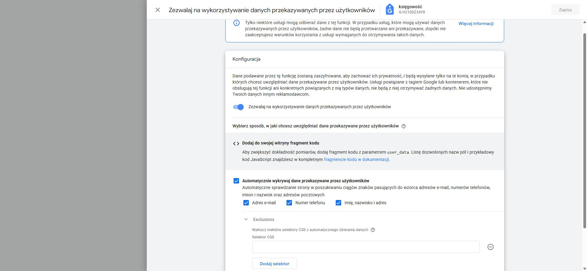
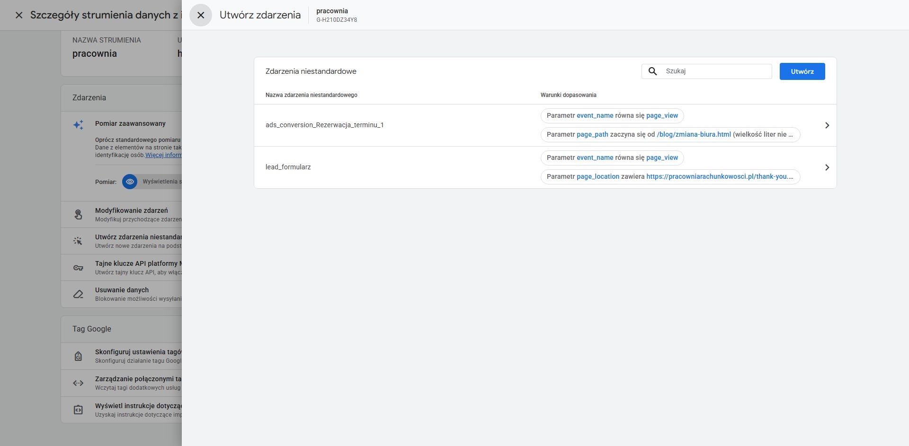
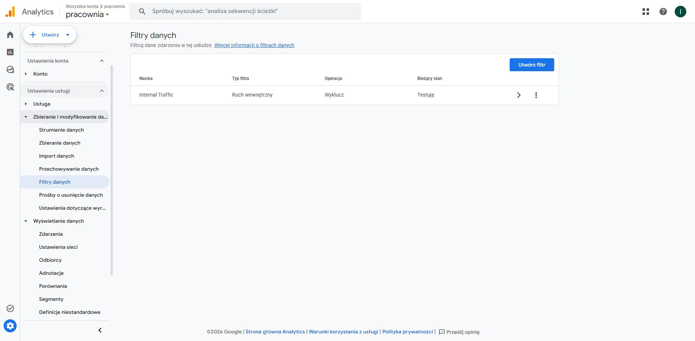

# Etap 6 — audyt globalnego UPD, Google Ads i izolacji GA4

Data odczytu: **11.10.2026**. [Polecenie właściciela](https://github.com/pracowniarachunkowosci-debug/pracownia/pull/19#issuecomment-6111483749), [draft PR #19](https://github.com/pracowniarachunkowosci-debug/pracownia/pull/19). Audyt dotyczy konfiguracji widocznej w panelach, nie potwierdza wysłania ani odbioru danych klientów.

**Wynik:** audyt wykonany; kontrolowany test GA4 **BLOCKED / NOT RUN, 0 prób**. Nie znaleziono odizolowanej właściwości testowej. Nie wysłano syntetycznego `generate_lead`, formularza Web3Forms ani konwersji do Ads/Meta. **GA4 produkcyjne nadal NIEPOTWIERDZONE.** Nie uruchamiano w tym etapie Preview ani witryny z produkcyjnymi tagami. Odczyt paneli administracyjnych nie jest testem kolektora witryny.

Gałąź `codex/zewnetrzny-dzial-finansowy`, punkt startowy/odczyt kodu `e8353c210ef3ee6010f6eb05e309956d703d60c9`; `origin/main` = `0bc0dec2f70753f2093fca645092de1910c32395`. Startowy HEAD zgodny z PR i gałęzią zdalną, drzewo czyste. Etap dodaje dokumentację i lokalny skrypt inwentaryzacji; nie zmienia HTML/JS strony, konfiguracji usług, cen ani pakietów. Nie wykonano merge ani publikacji.

## 1. Globalne UPD i enhanced conversions — odczytane

| Warstwa | Stan odczytany | Znaczenie |
| --- | --- | --- |
| Wspólny tag „księgowość” | `G-H210DZ34Y8`, `GT-NFR3Q2D`, `AW-17646661298`, `GT-NMC3NXLJ` | Zmiany ustawień globalnych nie czekają na publikację workspace |
| Miejsca docelowe tagu | GA4 „pracownia” `424296976`; Ads „KANCELARIA RACHUNKOWA BATOR SOŁTYS” `555-488-5593`, `AW-17646661298` | Wyłączenie globalnego UPD obejmuje wspólny tag i oba miejsca docelowe |
| Zezwolenie UPD / automatyczne wykrywanie | **ON / ON** | Nie wystarcza wstrzymanie osobnego tagu UPD w draft GTM |
| Automatyczne kategorie | E-mail **ON**, telefon **ON**, imię/nazwisko/adres **ON** | Możliwość pozyskiwania danych poza nowym zdarzeniem sukcesu |
| Ręczne CSS/JS / wykluczenia | Ręczne **OFF**; panel Exclusions ma pusty selektor | Nie znaleziono skonfigurowanych wykluczeń formularzy |
| Ads → ustawienia konwersji → EC WWW | **Włączone**, metoda **Menedżer tagów Google**; UI informuje, że EC są rejestrowane | Stan ustawienia i diagnoza UI, nie dowód odebrania nowego testu |
| Ads → EC potencjalnych klientów | **Włączone**, metoda **Tag Google** | Drugie aktywne ustawienie poza draft GTM |
| Ads → warunki danych klienta | Już zaakceptowane | Nie akceptowano nowych warunków |
| Ads działanie `7402979249` | EC zarządzane przez GTM; źródło „księgowość”, zdarzenie utworzone samodzielnie | Bezpośrednio dotknięty mechanizm formularza |
| GA4 → zbieranie danych → dane użytkowników | Funkcja **niewłączona** (przycisk „Włącz”) | Globalne UPD ON nie oznacza automatycznie odbioru UPD przez GA4 |
| GA4 Google Signals | Włączone | Osobny mechanizm; nie zmieniono go |

[Panel globalnego tagu](https://tagmanager.google.com/#/container/accounts/6214209173/containers/175836537/workspaces/0/config). Zapis był nieaktywny, nie przełączano opcji.

### Inne źródła i zakres wpływu

Świeży odczyt **produkcyjnej wersji GTM 4**, opublikowanej 08.12.2025: cztery tagi — Conversion Linker, Google tag `G-H210DZ34Y8`, natywna konwersja Ads oraz **Google Ads User-provided Data Event**. Dwa ostatnie korzystają ze starego `TechSol - form_submit 93474`. Jest jedna własna zmienna „Dane przekazywane przez użytkowników”. Wersja produkcyjna nie ma nowego tagu GA4 `generate_lead`.

W **workspace 6** pozostaje **7 zmian: 5 dodanych, 2 zmodyfikowane, 0 usuniętych**; nazwa „PR19 - Etap 5 - wariant A - NIE PUBLIKOWAC”. Tag 9 jest w draft wstrzymany, tag 5 bez `user_data`; globalne UPD pozostaje osobnym źródłem. Odczytano tag 14: `generate_lead` → `G-H210DZ34Y8`, trigger `CE - web3forms_success - approved forms`, dodatkowa zgoda `analytics_storage`; parametry `event_category=lead`, `event_label={{DLV - form_id}}`, `form_id`, `inquiry_source`. Nie zapisano zmian, nie otwierano Preview. Pełna walidacja par/Ads/UPD pochodzi z [etapu 5](../stage5/workspace-review.json), nie jest nowym testem kolektora.

[Powtarzalna inwentaryzacja źródeł](source-inventory.json), wygenerowana przez [audit-sources.py](audit-sources.py), obejmuje cały śledzony HTML/JS poza dokumentacją i testami:

| Kod | Dokumenty HTML | Pliki z `G-H210DZ34Y8` | Pliki z `GTM-WC88L2GJ` | Unia obu instalacji |
| --- | ---: | ---: | ---: | ---: |
| `origin/main` | 54 | 47 | 44 | 48 |
| Startowy HEAD PR | 55 | 47 | 45 | 48 |

47 to liczba plików z identyfikatorem, nie liczba żądań ani użytkowników. W PR usunięto bezpośredni GA4 z `thank-you.html`, dodano go na nowym landingu. Oprócz ZDF zmiana globalna może zatem dotyczyć głównej, oferty, pozostałych usług i bloga. Lista konkretnych adresów jest w JSON. Bezpośredni gtag i GTM występują równolegle; panel globalny ma zaznaczone ignorowanie duplikatów konfiguracji. Nie stanowi to dowodu deduplikacji wszystkich zdarzeń.

W repo są **3 rzeczywiste formularze Web3Forms**: główna oraz e-commerce i spółka z o.o. Wszystkie zachowują DOM id `leadForm`; wspólny moduł przekazuje odpowiednio analityczne identyfikatory `leadForm`, `ecommerceForm`, `spolkaForm`. Wejście ZDF korzysta z formularza głównej, dając czwartą dozwoloną parę źródła. Nie tworzono ponownie formularzy na sześciu stronach bez formularza. Wyłączenie UPD nie powinno zmienić POST do Web3Forms ani wiadomości — to wniosek z rozdzielenia kodu formularza i pomiaru, wymagający późniejszej weryfikacji po wdrożeniu.

W lokalnym HTML/JS nie znaleziono jawnego `user_data`, konfiguracji `enhanced_conversion` ani hashowania SHA-256. Flagi zgody `ad_user_data` nie są payloadem UPD. Nie znaleziono instalacji drugiego widocznego w koncie kontenera `GTM-PH3W7ZZ3` ani tagu `G-0DB6VY5G78` („oferta”) w tym repo. Nie dowodzi to, że nie są używane na innych witrynach. Zewnętrzne statyczne skrypty pochodzą z Google Tag Manager i GrowthOS; kod zewnętrznych skryptów, CRM/offline i innych witryn nie był uruchamiany ani objęty pełnym audytem.

Ads Data Manager pokazuje tag „księgowość” oraz po jednym połączeniu z GA4, Profilem Firmy Google i YouTube. Nie pokazuje połączonego CRM/źródła importu offline. To ograniczenie widocznego katalogu; **nie wyklucza niewidocznych integracji API lub ręcznych uploadów**. Bezpośrednie źródła UPD potwierdzone w zakresie to globalny skaner oraz produkcyjne GTM/zmienna UPD. Nie przypisujemy niepotwierdzonego wysyłania PII do GrowthOS ani innych usług.

## 2. Google Ads — kampanie i cele

Odczyt konta **555-488-5593**, wewnętrzny parametr konta `ocid=7707152761`. Lista kampanii pokazuje cztery pozycje; status kampanii „Wszystkie”, status grup w widoku włączone/wstrzymane. Dodatkowo globalny komunikat konta potwierdza, że żadna reklama nie jest aktywna. **0 aktywnych, 2 wstrzymane, 2 usunięte**. Szkic „Leads-Search-2” nie jest aktywną kampanią i nie był modyfikowany. Nie ma obecnie aktywnej kampanii, której stawki można przypisać do błędnego celu; istnieje ryzyko po wznowieniu dwóch wstrzymanych.

| Kampania | Status | Strategia odczytana | Cele / wpływ fałszywej rezerwacji |
| --- | --- | --- | --- |
| Leads 15.11 (`23268118724`) | Wstrzymana; Search | Maksymalizuj liczbę konwersji, bez pokazanego docelowego CPA | Domyślne konta; **Rezerwacja terminu uwzględniona** |
| Performance Max-2-OPT (`23336910409`) | Wstrzymana; Performance Max | Maksymalizuj liczbę konwersji | Domyślne konta; **Rezerwacja terminu uwzględniona** |
| Powierz nam swoją księgowość | Usunięta; Performance Max | Maksymalizuj liczbę konwersji | Bez aktywnej optymalizacji; nie edytowano |
| Kampania 3, utworzona 7.11.2025 14:31 | Usunięta; Smart | Maksymalizuj liczbę kliknięć | Bez aktywnej optymalizacji; nie edytowano |

W obu wstrzymanych kampaniach odczytano sześć kategorii domyślnych: formularze, połączenia telefoniczne, kontakty (tylko jedno z dwóch źródeł), rezerwacje, zaangażowanie i wyświetlenia po reklamie YouTube. **Brak nadpisania celów przez ustawienia kampanii.** W podsumowaniu konwersji rozwinięta tabela celów niestandardowych: **„Nie masz żadnych celów niestandardowych”**. W tym stanie nie ma wyjątku custom-goal przywracającego Secondary do stawek. Przed przyszłą zmianą trzeba ponownie odczytać stan, ponieważ może się zmienić.

| Działanie | Źródło / stan | Bidding i problem |
| --- | --- | --- |
| `7372277673` Rezerwacja terminu | GA4 `ads_conversion_Rezerwacja_terminu_1`; Primary, każda konwersja, 90 dni | Domyślny cel, 2/2 nieusunięte kampanie. Reguła dotyczy wczytania artykułu, a nie rezerwacji |
| `7402979249` TechSol - Formularz kontaktowy 69747 | Natywne WWW; Primary, jedna konwersja, 30 dni; EC przez GTM | Jeden rekomendowany Primary formularza **po naprawie i odbiorze**. Obecna produkcyjna reguła GTM nadal odpala na submit, więc sam dobór tego działania nie kończy naprawy |
| `7382427293` pracownia (web) lead_formularz | GA4 `lead_formularz`; Secondary, każda konwersja, 90 dni | Nie uwzględnione w celach konta; brak użycia w custom goals. Stara definicja odsłony podziękowania nie potwierdza sukcesu API |
| `generate_lead` | Nie znaleziono w pełnej liście **16 działań**, obie strony tabeli, filtr statusu „Wszystkie” | Nie dodano nowego importu ani drugiego Primary |

Pełna lista obejmuje również połączenia z reklam, działania lokalne oraz YouTube. Domyślne źródła zaangażowania obejmują subskrypcje YouTube, a kolejna kategoria — follow-on views. To dodatkowa decyzja o definicji wartościowego leada, nie automatyczna rekomendacja wyłączenia wszystkich połączeń. Działania typu wyznaczenie trasy, lokalne wizyty w witrynie czy lokalne kliknięcia nie są obecnie uwzględnione w celach konta. Nie zmieniano tych ustawień.

W panelu był historyczny zakres statystyk 13.05–09.06.2026. **Nie użyto wyświetlanych liczb konwersji do oceny aktualnej skuteczności ani skali błędu.** Statusy i ustawienia odczytano bieżące; etykieta „brak konwersji w ostatnim czasie” nie dowodzi sprawności ani niesprawności całego transportu.

### Potwierdzone reguły GA4

W produkcyjnym strumieniu reguły tworzenia zdarzeń:

- `ads_conversion_Rezerwacja_terminu_1`: `event_name = page_view` i `page_path` zaczyna się od `/blog/zmiana-biura.html` (bez rozróżniania wielkości liter).
- `lead_formularz`: `event_name = page_view` i `page_location` zawiera `https://pracowniarachunkowosci.pl/thank-you.html` (bez rozróżniania wielkości liter).

To potwierdzone błędy znaczenia sygnału. Nie wyliczano, ile historycznych konwersji było fałszywych, i nie modyfikowano historii. Samo kliknięcie Calendly ani artykuł nie dowodzi umówionego spotkania.

## 3. GA4 — izolacja i wynik testu

Konto `299785209`, właściwość **pracownia `424296976`**. Strumień witryny `6664086356`, pomiar **`G-H210DZ34Y8`**. Drugi strumień „Pracownia Form” `15187827072` dotyczy innej witryny i leży w tej samej właściwości; **nie jest odizolowanym środowiskiem testowym**. W koncie „pracownia” nie znaleziono drugiej właściwości. Inne konta widoczne w selektorze dotyczą innych marek i nie zostały użyte jako sandbox.

Jedyny filtr: **Internal Traffic → Exclude → Testing („Testuję”)**. Nie ma aktywnego filtra developer traffic. `debug_mode` sam nie zapewnia wyłączenia z raportów; Testing oznacza oznaczanie danych, a nie ich odrzucanie. [Dokumentacja filtrów deweloperskich](https://support.google.com/analytics/answer/13296662?hl=en), [DebugView](https://support.google.com/analytics/answer/7201382?hl=en).

GA4 ma dwa połączenia Ads: konto reklamowe `555-488-5593` (personalizacja wyłączona na tym połączeniu) oraz konto menedżera `659-994-2321` (personalizacja włączona). Wyłączenie personalizacji na jednym linku nie izoluje właściwości od importu konwersji ani drugiego połączenia. Nie edytowano integracji. Globalny tag dodatkowo ma miejsce docelowe Ads.

**Decyzja techniczna: zatrzymać test przed przygotowaniem emisji.** Nie można potwierdzić wymaganej izolacji produkcyjnych raportów. Nie zmieniano filtrów produkcyjnych, nie tworzono nowej właściwości ani nie obchodzono zgód/CSP. Brak izolacji jest wystarczającym powodem przerwania; nie sprawdzano kolejnych transportów przez próbne hity do produkcji.

| Kryterium odbioru | Wynik etapu 6 |
| --- | --- |
| Dozwolony limit | Maksymalnie 1, wyłącznie przy zapewnionej izolacji |
| Rzeczywiste próby `generate_lead` | **0** |
| Syntetyczny push / uruchomienie tagu / żądanie kolektora | Nie wykonano |
| HTTP / DebugView / Realtime | Brak nowego wyniku; test nie wystartował |
| GA4 test | **BLOCKED / NOT RUN** |
| GA4 produkcyjne | **NIEPOTWIERDZONE** |
| Web3Forms / Ads / Meta / Calendly / GrowthOS w teście | **0 rzeczywistych wysyłek testowych** |

Maszynowy zapis: [ga4-test-result.json](ga4-test-result.json). Minimalny następny krok: wskazać odrębną właściwość testową lub zatwierdzić utworzenie nowej z niezależnym tagiem, bez powiązań Ads. [Dokładny plan testu i zatwierdzeń](approval-plan.md).

## 4. Weryfikacja i otwarte kwestie

- Sprawdzono konfigurację przez widoczne panele GTM/GA4/Ads, bez zapisów. Workspace 6 pozostaje nieopublikowany, aktywna wersja GTM 4 bez zmian.
- Uruchomiono lokalną inwentaryzację obu commitów; zapis nie zawiera wartości pól, kluczy formularza ani danych klientów. Trzy dowody graficzne obejrzano przed dołączeniem.
- **10 kontroli PASS**: składnia nowego skryptu i `node --check assets/js/contact-form.js`, ponowne `python scripts/audit-form-migration.py --verify` (2 formularze / 6 stron bez formularza), spójność inwentaryzacji i wyniku GA4, zakres zmian, JPEG, JSON, 30 lokalnych odnośników oraz `git diff --check` / `git diff --cached --check`. Wynik w [qa-report.json](qa-report.json). Zakres zmian ograniczony do dokumentacji; ponowny audyt nie zmienił wcześniejszych raportów.
- Nie powtarzano testów przeglądarkowych formularza — kod strony i draft GTM nie uległy zmianie. [87 kontroli / 96 atrap oraz Preview etapu 5](../stage5/README.md) pozostają wynikami **etapu 5**, nie wynikiem nowego testu GA4.
- **Copy do decyzji:** `ksiegowosc-ecommerce.html` FAQ nadal dopuszcza przejęcie księgowości w trakcie roku; ZDF komunikuje styczeń 2027. W odczytanej reklamie wstrzymanej kampanii Leads również występuje onboarding w trakcie roku. Nie zmieniano treści; wymaga ujednolicenia przed publikacją/wznowieniem zgodnie z decyzją właściciela.
- Pełny wariant A nie jest jeszcze wdrożony: globalny UPD i oba ustawienia EC Ads są aktywne, stary produkcyjny GTM działa na submit. Nie deklarujemy braku PII w całej produkcyjnej telemetrii na podstawie bezpiecznego payloadu nowego modułu.
- Nie potwierdzono braku wszystkich źródeł UPD poza repo, odczytanym GTM i widocznym Data Managerem. Przed wyłączeniem trzeba uzgodnić z właścicielem ewentualne CRM/API/pozostałe witryny. Nie stwierdzono blokady uprawnień ani potrzeby jej obchodzenia; pojedynczy timeout zrzutu Ads ograniczył materiał graficzny, ale odczyt DOM ustawień był dostępny.

**Następne decyzje właściciela:** izolowana właściwość testowa i jedna próba; wyłączenie globalnego UPD oraz obu ustawień EC Ads; wykluczenie działania `7372277673` z optymalizacji; docelowy jeden Primary formularza i porządek pozostałych celów; spójność copy; osobne okno publikacji kodu/GTM i późniejszy odbiór produkcyjny. Żadna z tych zmian nie została wykonana w etapie 6.
