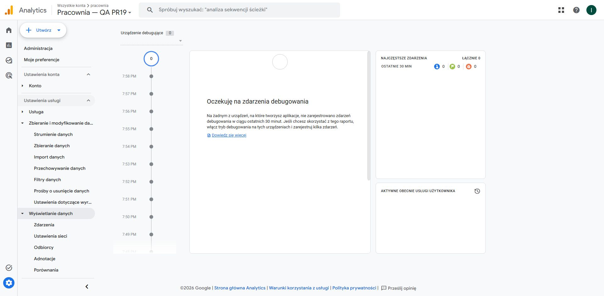

# Etap 7 — niezależna GA4 QA i jedna próba odbioru

11.10.2026. [Polecenie etapu 7](https://github.com/pracowniarachunkowosci-debug/pracownia/pull/19#issuecomment-6111801396), [draft PR #19](https://github.com/pracowniarachunkowosci-debug/pracownia/pull/19). Początkowy HEAD `09cbc8e1939ec2db8cc12c5739d4c7761d4c69ce`; gałąź `codex/zewnetrzny-dzial-finansowy` była czysta i zgodna z PR. `main`: `0bc0dec2f70753f2093fca645092de1910c32395`.

**Wynik: właściwość QA utworzona, izolacja PASS; odbiór `generate_lead` NIEPOTWIERDZONY.** Jedyna lokalna próba została zużyta o **17:59:40 UTC / 19:59:40 CEST**. Powstał jeden syntetyczny `web3forms_success` i jedno wywołanie odpowiednika tagu GA4; nie zaobserwowano żądania pomiarowego do lokalnej bramki, niczego nie przekazano kolektorowi Google i nie ma odpowiedzi HTTP kolektora. DebugView QA pokazał **0 urządzeń / 0 zdarzeń**. Nie ponowiono próby. **Nie jest to PASS pomiaru ani dowód awarii właściwości produkcyjnej. Produkcyjne GA4 pozostaje NIEPOTWIERDZONE.**

## 1. Utworzone zasoby i izolacja konfiguracji

| Element | Stan potwierdzony w UI |
| --- | --- |
| Konto | istniejące `pracownia`, `299785209`; przed utworzeniem nie było właściwości QA |
| Nowa właściwość | **Pracownia — QA PR19**, `558476651` |
| Jeden strumień WWW | **PR19 QA — local only**, `16107592543` |
| Measurement ID | **G-CRJHZ0T8X9**, inne niż produkcyjne `G-H210DZ34Y8` |
| Niezależny Google tag | `G-CRJHZ0T8X9`, `GT-NMKN6VLT`; jedno miejsce docelowe — powyższy strumień QA |
| URL strumienia | `https://qa-pr19.invalid` — techniczna nazwa testowa, bez wdrożenia witryny |
| Zasięg konfiguracji | Polska, czas Polska, PLN; cel „Inne cele biznesowe” |
| Ads, w tym MCC | **0 połączeń**, 0 oczekujących/proponowanych integracji; nie tworzono importów konwersji |
| Połączone tagi witryny | **0**; brak wspólnego produkcyjnego Google tag |
| Google Signals / GA4 user-provided data | niewłączone — UI oferuje przyciski „Włącz” |
| UPD nowego tagu QA | domyślnie ON/autodetect ON; w ramach izolacji nowej QA wyłączono autodetect i całe zezwolenie UPD; UI potwierdził zapis |
| Enhanced measurement | **OFF przed utworzeniem strumienia**; w lokalnym config dodatkowo `send_page_view:false` |
| Personalizacja reklam QA | **0 z 307 regionów**; szczegółowe dane o lokalizacji/urządzeniu OFF |
| User-ID | nie skonfigurowano ani nie podawano; `uid`, `user_data` i user properties odrzucane przez bramkę |
| Odbiorcy | tylko domyślne All Users/Purchasers; bez eksportu reklamowego, ponieważ brak połączeń i personalizacja OFF |
| Import danych | 0 źródeł; nie tworzono klucza Measurement Protocol |

Kreator wymagał metadanych firmy: wybrano Finanse i najmniejszą kategorię 1–10 dla technicznej QA; nie jest to audyt faktycznego zatrudnienia. Nie rozszerzano dostępu do kont i nie akceptowano nowych warunków. Produkcyjna właściwość `424296976`, wspólny tag „księgowość”, globalne produkcyjne UPD/EC i aktywne ustawienia Ads pozostały bez zmian. Wyłączenia w tabeli dotyczą **wyłącznie nowo utworzonej QA**, nie realizują produkcyjnego wariantu A.

[Brak połączeń Ads](qa-ads-links.png), [UPD QA wyłączone](qa-upd-off.png), [ustawienia zbierania danych QA](qa-collection-settings.png). [DebugView tej właściwości](https://analytics.google.com/analytics/web/?hl=pl#/a299785209p558476651/admin/debugview/overview).

## 2. Preflight i metoda jednorazowej próby

Przygotowano lokalny odpowiednik tagu 14 i wyzwalacza CE13 dla jednej pary `leadForm / zewnetrzny-dzial-finansowy`. Nie ładowano produkcyjnego kontenera, kodu formularza ani skryptów Meta, Calendly i GrowthOS. Nie uruchamiano GTM Preview workspace 6. Ten test nie zastępuje testów samego GTM Preview z etapu 5.

Lokalna ramka miała `sandbox="allow-scripts"` (bez formularzy, popupów, dostępu do nadrzędnej strony i same-origin). CSP blokowała wszystkie zewnętrzne skrypty, obrazy, ramki, workery, formularze i połączenia. CSP rodzica ograniczała nawigację ramki do własnego lokalnego serwera. Testy fetch, XHR, sendBeacon, img, iframe, form, top navigation, popup i self navigation kierowano wyłącznie do **lokalnej atrapy**. Wynik: **0 żądań do atrapy**, wymagane naruszenia CSP i blokady nawigacji potwierdzone. Przeprowadzenie formularzowej sondy transportu nie używało Web3Forms ani formularzy witryny.

17 testów Node na atrapach zaliczyło m.in. dokładne mapowanie parametrów, zgodę analytics, odrzucenie produkcyjnego ID/Ads, innych zdarzeń, PII/UPD/User-ID, partii, duplikatów oraz trwały bezpiecznik zużywany przed transportem, również przy timeout. Następnie powtórzono preflight transportu w procesie z przygotowaną bramką; nadal **0 syntetycznych zdarzeń i 0 transmisji do Google przed kliknięciem próby**. [Wynik offline](offline-preflight.json), [dowód przeglądarkowy](offline-preflight.png).

Jedynym potencjalnym wyjściem pomiarowym był lokalny serwer: stały host/path kolektora, stałe QA ID, sprawdzane URL i body, dokładne `en=generate_lead`, cztery oczekiwane parametry, syntetyczne identyfikatory i wymagany stan analityki. Przy dopuszczeniu bramka rekonstruuje minimalny payload z allowlisty, bez nagłówków klienta, cookies, User-ID, URL użytkownika i pól formularza. Nie przekazuje surowego requestu ani dowolnych dodatkowych parametrów. Połączenie HTTPS nie ponawia żądań ani nie podąża za przekierowaniami. Identyfikatory syntetyczne istnieją tylko w pamięci i nie są w raporcie.

Bibliotekę Google tag dla **wyłącznie QA ID** pobrano z oficjalnego źródła i podano lokalnie; browser nie dostawał dostępu sieciowego do domen Google. Pobranie konfiguracji nie jest zdarzeniem pomiarowym. SHA-256 kopii: `72d089ae2c877d63476fa35d66eb5987c36bf1e513010b695252200f27f8c819`. Biblioteka i pełne backupy GTM pozostają poza repozytorium.

| Parametr testowego zdarzenia | Wartość |
| --- | --- |
| `event_category` | `lead` |
| `event_label` | `leadForm` |
| `form_id` | `leadForm` |
| `inquiry_source` | `zewnetrzny-dzial-finansowy` |

`debug_mode:true` dodano wyłącznie do tej próby. Przed kliknięciem świadomie zaznaczono zgodę `analytics_storage=granted`; `ad_storage`, `ad_user_data` i `ad_personalization` ustawiono na denied, oba `allow_*signals` na false. To samo w sobie nie zapewnia izolacji: dodatkowo działały blokady transportu i niezależna konfiguracja QA.

## 3. Wynik i ograniczenie diagnozy

- **1** kliknięcie próby, **1** syntetyczny `web3forms_success`, **1** wywołanie lokalnego odpowiednika `generate_lead` do kolejki gtag.
- **0** przychodzących żądań pomiarowych do bramki i **0** wyjściowych do Google; odpowiedź API/HTTP: **brak, nie wysłano requestu**.
- **DebugView QA: brak zdarzenia**, nie można sprawdzić jego parametrów po stronie GA4. Cztery parametry zweryfikowano wyłącznie lokalnie.
- **Web3Forms: 0 rzeczywistych POST; Google Ads: 0 prób konwersji; Meta/Calendly/GrowthOS: 0 emisji z fixture.** Te liczniki nie dotyczą technicznego ruchu paneli administracyjnych.
- Około 18:00:40 UTC zamknięto kartę i zatrzymano serwer. Trwały znacznik syntetycznej próby pozostawiono zużyty. Nie wykonano drugiego push, fallbacku do innego kolektora ani ponownego ładowania próby.

Nie ustalono dokładnej przyczyny braku żądania z natywnej biblioteki. Nie ma dowodu pozwalającego rozstrzygnąć, czy problem dotyczył jej inicjalizacji w izolowanej ramce, storage czy innego warunku runtime. Nie należy przypisywać tego wyniku błędnej konfiguracji produkcyjnej GA4. Flaga `sent:true` na ekranie fixture oznacza wykonanie lokalnego wywołania, **nie wysłanie requestu**; rozstrzygające są `upstreamAttempts:0` i pusty DebugView.

**Przeszkoda do kolejnej próby:** brakuje potwierdzonej inicjalizacji natywnej biblioteki w tym restrykcyjnym środowisku. Najpierw trzeba dodać diagnostykę load/error i sprawdzić ją offline bez generowania kolejnego `web3forms_success`/`generate_lead`. Ewentualny osobny lokalny origin z działającym storage wymaga ponownego dowodu pełnych blokad, w tym nawigacji ramki; nie wolno po prostu usuwać sandbox/CSP. Dopiero po tym i nowej zgodzie właściciela można rozważyć kolejną pojedynczą próbę w **tej samej QA**, bez tworzenia następnej właściwości.

[Wynik maszynowy](ga4-test-result.json), [stan bramki](network-result.json), [dowód próby](single-attempt.png).



## 4. GTM, kod i walidacja końcowa

Eksport workspace 6 przed: **17:47:35 UTC**, po: **18:04:25 UTC**. Porównano wszystkie obiekty, parametry i ich fingerprints. Różnią się wyłącznie metadane eksportu: `exportTime` oraz generowany `containerVersion.fingerprint`. **Konfiguracja identyczna**; wspólny SHA-256 po odjęciu tych metadanych: `5e7139d8bb5337b36a2469f0196d0846cf8719dd8147a3aec4c54bae9d6a6867`. Surowe sumy są różne i podane w [raporcie porównania](workspace-comparison.json).

Workspace nadal ma **7 zmian: 5 dodanych, 2 zmodyfikowane, 0 usuniętych**; 5 tagów, 3 wyzwalacze, 4 zmienne własne i 44 wbudowane. Produkcyjne ID tagu 14 zachowane; QA ID nie występuje w eksporcie. Ads 5 nadal tylko CE13, bez `user_data`; UPD 9 paused. Brak override w workspace, więc nie importowano backupu i nie nadpisywano konfiguracji. Wersja produkcyjna GTM nadal 4; nic nie opublikowano.

| Kontrola | Wynik |
| --- | --- |
| Preflight bramki przed próbą | 17/17 PASS, bez sieci |
| Preflight transportu w browser | PASS, lokalna atrapa 0 requestów; wykonany przed próbą |
| Końcowy zestaw Node | **18/18 PASS**, dodatkowo blokada ponownego uzbrojenia archiwum |
| Integracje / HTML / JS | **14 stron, 50 bloków JS**, 0 nowych problemów HTML względem main; 4 grupy kontroli integracji PASS |
| Porównanie eksportów workspace 6 | PASS, tylko wskazane metadane eksportu różne |
| Składnia helperów i `contact-form.js` | PASS |
| JSON, lokalne linki dokumentacji, zakres zmian, `git diff --check` | PASS — szczegóły w `qa-report.json` |
| Odbiór QA / produkcja | **NIEPOTWIERDZONY / NIEPOTWIERDZONY** |

Nie zmieniono HTML/JS/CSS strony, cen, pakietów ani integracji. Dodano dokumentację i lokalne skrypty QA. Po zamknięciu próby dopisano w helperze stałą blokadę `STAGE7_CLOSED`: zapisany w repo skrypt nie może wysłać kolejnej próby nawet przy podaniu nowego katalogu stanu. To jedyna zmiana wykonawcza helpera po zarejestrowanym teście; zweryfikowana offline. Pierwsze uruchomienie walidatora HTML wymagało wskazania istniejącego `NODE_PATH`; po wskazaniu lokalnych zależności test przeszedł. Pierwszy serwer w sandbox nie był osiągalny w przeglądarce; zatwierdzone uruchomienie lokalne poza sandbox umożliwiło preflight. Nie obchodzono mechanizmu zatwierdzania.

Powtarzalne kontrole offline:

```powershell
node --test scripts/verify-ga4-stage7.cjs
node --check scripts/qa-ga4-stage7.cjs
node --check scripts/verify-ga4-stage7-workspace.cjs
node --check assets/js/contact-form.js
node scripts/verify-integrations.cjs # istniejące html-validate przez NODE_PATH; ZDF_QA_OUTPUT=stage7
git diff --check
```

Źródła metody: [parametry prywatności gtag](https://developers.google.com/analytics/devguides/collection/ga4/reference/config), [lokalne kierowanie transportu przez server_container_url](https://developers.google.com/tag-platform/tag-manager/server-side/send-data?option=gtag), [manualne pageviews](https://developers.google.com/analytics/devguides/collection/ga4/views?technology=websites), [warunek potwierdzenia w DebugView](https://support.google.com/analytics/answer/7201382?hl=en). Nasza bramka QA nie jest wdrożonym serwerowym kontenerem GTM.

## 5. Decyzje właściciela

1. **Nowa zgoda na ewentualną następną pojedynczą próbę QA**, dopiero po diagnozie inicjalizacji i pełnym offline preflight. Obecna zgoda jest zużyta mimo braku requestu do Google. Nie potrzeba kolejnej właściwości.
2. **Produkcja: wyłączenie globalnego UPD i obu ustawień EC Ads**, z ustaleniem pozostałych witryn/CRM/API używających wspólnego tagu; [konkretny plan etapu 6](../stage6/approval-plan.md#b-pełny-wariant-a--globalne-upd-i-ec) pozostaje niewykonany.
3. **Fałszywa „Rezerwacja terminu” `7372277673`: Secondary i usunięcie z optymalizacji**, po ponownym odczycie kampanii/celów. Osobno stare reguły GA4 i mikrocele YouTube. Nie wprowadzać drugiego Primary dla tego samego leada.
4. **Treści i przyszłe wdrożenie:** uzgodnić FAQ/reklamy o przejęciu ksiąg względem stycznia 2027; dopiero po weryfikacji zaakceptować wspólne okno strona + GTM i zakres odbioru produkcji. Nie zatwierdzono merge, publikacji, rzeczywistych formularzy, Ads ani wznowienia kampanii.

Nową QA pozostawiono do dalszej diagnostyki, bez ruchu z witryny. Nie usuwano właściwości ani nie włączano automatycznego testu. W tym etapie nie wykonano żadnej z decyzji produkcyjnych.
